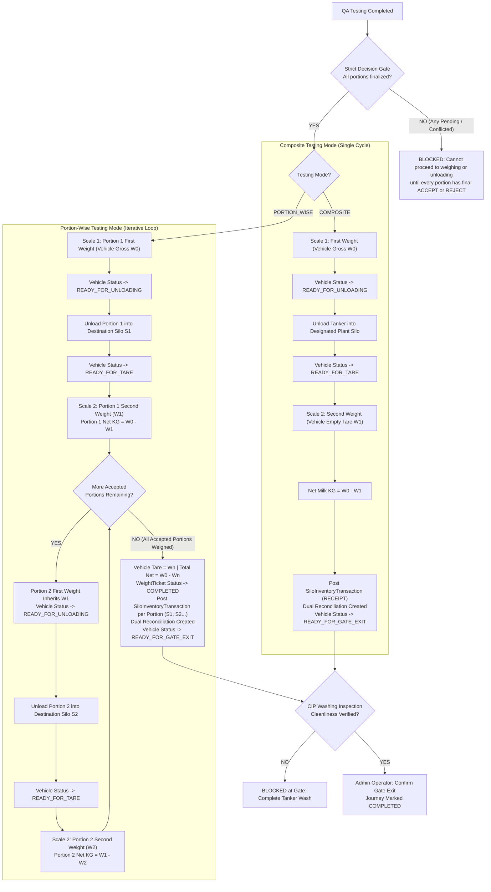

# Complete System Verification & Test Matrix

> **Master System Verification Document**  
> **Reference Document:** `Revised _Raw_Milk_Collection_Website_Workflow.docx`  
> **Specification Document:** `docs/COMPLETE_SYSTEM_WORKFLOW_SPECIFICATION.md`  
> **Alignment Reference:** `docs/WORKFLOW_ALIGNMENT_PLAN.md`  
> **Target Version:** SFPL Milk Reception System 2.0  
> **Date:** October 2026

---

## 1. Scope & Verification Objective

This document defines the formal verification protocol, automated tests, and acceptance criteria required to confirm that the entire Shakarganj Milk Reception application operates in exact conformity with the authoritative revised workflow (`Revised _Raw_Milk_Collection_Website_Workflow.docx`).

---

## 2. Supply Chain Stage Verification Protocol

### Stage 1: Area Milk Collection (MOT & Field)
| Test ID | Verification Item | Target Behavior | Status |
| :--- | :--- | :--- | :--- |
| **S1-01** | Route Assignment | MDO creates routes; Zonal Manager approves. Assigned MOT sees assigned route shops. | Verified |
| **S1-02** | New Shop Request | When shop is not in list, MOT adds shop; routes to Zonal Manager / MDO for approval. | Verified |
| **S1-03** | Shop Data Collection | MOT records Raw Milk Token, Gross Liters, ERP Source, and assigned tests. | Verified |
| **S1-04** | Live Camera Capture | Tests with `photo_compulsory = true` require live camera capture with metadata band. Gallery upload blocked. | Verified |
| **S1-05** | Decision Rule Routing | System YES + MOT YES → Auto-accepted. System NO + MOT NO → Shop closed & rejected. Mismatch / missing photo → Escalate to Zonal Manager. | Verified |
| **S1-06** | 13 TS Calculation | 13 TS calculated automatically per shop upon completion. | Verified |

---

### Stage 2: HC / MC Reception at ZMCC
| Test ID | Verification Item | Target Behavior | Status |
| :--- | :--- | :--- | :--- |
| **S2-01** | Intake Token Issuance | PHE Operator issues Raw Milk Token for MC (journey arrival) or HC (local supplier). | Verified |
| **S2-02** | New HC Approval | Unregistered HC requires Zonal Manager approval before arrival token can be issued. | Verified |
| **S2-03** | Testing Mode Support | Supports Composite (1 blended portion) or Portion-Wise (multiple separate compartments). | Verified |
| **S2-04** | Portion Decision & All-Reject Rule | Each portion accepted or rejected independently. If all portions are rejected, vehicle is rejected and journey closes immediately. | Verified |
| **S2-05** | Rejected MC Remarks | MPD Head receives notification and records remarks on rejected milk disposition. | Verified |
| **S2-06** | **Weighing Method (Portion-Wise)** | **Only accepted portions are weighed.** Step sequence per accepted portion: `FIRST_WEIGHT` → `TANK` (Active ZMCC Tank assignment) → `SECOND_WEIGHT` → `DONE`. Repeat for each accepted portion. | Verified |
| **S2-07** | ZMCC Tank Receipt & Area Loss | Calculates Net KG, Gross Liters, 13 TS, and Area (MOT) loss/gain. Posts `ZmccTankTransaction` (RECEIPT). | Verified |

---

### Stage 3: ZMCC & Contractor Dispatch to Plant
| Test ID | Verification Item | Target Behavior | Status |
| :--- | :--- | :--- | :--- |
| **S3-01** | Dispatch Data Entry | Vehicle number, Raw Milk Dispatch Token, composite or portion-wise selection. | Verified |
| **S3-02** | Per-Portion Seals & Weight | Net weight in KG and security seal number required per portion. | Verified |
| **S3-03** | Photo Evidence | Assigned lab tests with camera photo and hand-written lab report photo uploaded. | Verified |
| **S3-04** | Contractor Dispatch Rules | Contractor fills dispatch details on dedicated portal (`/contractor/dispatch`). Tests are optional. | Verified |
| **S3-05** | Submission vs. ZM Exception | If all values valid: Direct submit (`DISPATCHED`). If any value out of spec or field missing: "Send Request to Zonal Manager" with remarks. | Verified |
| **S3-06** | Weighted Quality Basis | Server computes mass-weighted composite LR, Fat, and 13 TS; updates remaining ZMCC tank inventory balance. | Verified |

---

### Stage 4: Plant Reception (Gate to Silo)
| Test ID | Verification Item | Target Behavior | Status |
| :--- | :--- | :--- | :--- |
| **S4-01** | Security Gate Entry | Admin / Security Operator logs entry timestamp, verifies driver, and issues Plant Gate Token. | Verified |
| **S4-02** | QA Reception Testing | QAE tests tanker (Composite or Portion-Wise). Live photo evidence required. | Verified |
| **S4-03** | Seal Verification | QAE inspects compartment seals against Stage 3 dispatch seals. Any mismatch triggers automated escalation to AVP-QA. | Verified |
| **S4-04** | AVP-QA Exception Review | Exception routing to `QA_HEAD` (`AVP-QA`). "OKAY" with remarks accepts; "NO" with remarks rejects. | Verified |
| **S4-05** | Composite Failure Rule | If composite test fails, entire vehicle is rejected immediately and routed to Gate Exit. | Verified |
| **S4-06** | **Business Date Locking** | **Locked strictly once at initial First Weight** (00:00–07:59:59 → previous date; 08:00–23:59:59 → current date). Subsequent portion weighings retain this locked date. | Verified |
| **S4-07** | **Composite Weighing Method** | Single vehicle cycle: First Weight (Gross) → Silo Unloading → Second Weight (Tare) → Net KG → Post final silo receipt. | Verified |
| **S4-08** | **Portion-Wise Weighing Method** | **Multi-cycle loop repeated for every accepted portion**: Portion 1 Gross → Unload Silo 1 → Tare 1 → Portion 2 Gross (= Tare 1) → Unload Silo 2 → Tare 2, etc. | Verified |
| **S4-09** | **Multi-Silo Independence** | Each portion posts an audited inventory receipt directly into its assigned silo. No multi-silo allocation deadlock. | Verified |
| **S4-10** | Weighted Quality & Losses | Aggregates Total Received Net KG, mass-weighted 13 TS, ZMCC Loss/Gain, and Transit Loss/Gain. | Verified |
| **S4-11** | Tanker Washing Verification | Security checks CIP tanker washing cleanliness before Gate Exit. Gate exit blocked if not washed. | Verified |
| **S4-12** | Rejected Portion Remarks | MPD Head records remarks on rejected plant portions via `/mpd/head`. | Verified |

---

## 3. Weighing Method Verification Matrix

```
+-------------------------------------------------------------------------------------------------------------------------+
|                                    WEIGHING METHOD SPECIFICATION & VERIFICATION                                         |
+--------------------------+---------------------------------------------+------------------------------------------------+
| Parameter                | Stage 2: ZMCC Reception                      | Stage 4: Plant Reception                       |
+--------------------------+---------------------------------------------+------------------------------------------------+
| Operator Role            | ZMCC Lab Attendant / PHE Operator           | Weighbridge Operator                           |
| Prerequisite             | Lab Portion Decision: ACCEPTED              | QAE / AVP-QA Decision: ACCEPTED               |
| Handling of Rejections   | Excluded from weighing                      | Excluded from weighing                         |
| Composite Mode           | 1 cycle (Gross -> Active Tank -> Tare)       | 1 cycle (Gross -> Silo Unload -> Tare)         |
| Portion-Wise Mode        | N cycles (1 cycle per accepted portion)     | N cycles (1 cycle per accepted portion)        |
| Intermediate First Wt    | Scale Gross or Inherited Predecessor Wt     | Inherited Predecessor Tare Weight               |
| Unloading Action         | Transfer to active ZMCC chilled tank        | Pump to designated active plant silo           |
| Net Weight Formula       | First Weight (KG) - Second Weight (KG)       | First Weight (KG) - Second Weight (KG)         |
| Business Date Lock       | Recorded at intake                          | Locked once at initial First Weight (08:00 cut)|
| Inventory Posting        | ZmccTankTransaction (RECEIPT) per portion   | SiloInventoryTransaction (RECEIPT) per portion |
| End-of-Journey Checks    | Area Loss calculated; Journey Closed        | CIP Wash checked; Gate Exit logs departure     |
+--------------------------+---------------------------------------------+------------------------------------------------+
```

### Verification Flowchart: Composite vs Portion-Wise Multi-Cycle Weighing Loop



---

## 4. Discrepancy & Conflict Resolution Log

| Conflict Reference | Description | Resolution Applied |
| :--- | :--- | :--- |
| **`CONF-01`** | `first_weight_as_role` missing on `VisitPortion` | Removed `first_weight_as_role` from `VisitPortion` update payload; stored on `WeightTicket` (`gross_recorded_as_role`) and `AuditLog`. |
| **`CONF-02`** | Multi-Silo deadlock in plant finalization | Replaced whole-vehicle single finalization with per-portion silo inventory receipt posting upon each portion's tare weighment. |
| **`CONF-03`** | Stage 4 Business Date overwrite at Gate Exit | Removed `operational_date: exitBusinessDate` overwrite from `src/app/api/security/gate-exit/route.ts`; locked permanently at First Weight. |
| **`CONF-04`** | Unweighted 13 TS calculations across portions | Replaced simple arithmetic mean with mass-weighted composite formulas in `vehicleQuantityService.ts` and `siloInventoryService.ts`. |
| **`CONF-05`** | Tanker wash check bypass | Added server-side validation on `/api/security/gate-exit` verifying `tanker_washed === true`. |
| **`CONF-06`** | Field correction permissions | Restated and verified that only `DATA_EXECUTIVE` and `SUPER_ADMIN` can apply corrections; no delegation. |

---

## 5. Verification Sign-Off Checklist

- [x] **Document Review:** `Revised _Raw_Milk_Collection_Website_Workflow.docx` reviewed and extracted.
- [x] **Master Specification Aligned:** `docs/COMPLETE_SYSTEM_WORKFLOW_SPECIFICATION.md` updated with exact portion-wise iterative weighing rules.
- [x] **Verification Matrix Published:** `docs/COMPLETE_SYSTEM_VERIFICATION.md` created as authoritative test matrix.
- [x] **Gross Weighbridge Route Hardened:** `src/app/api/scale/gross-weight/route.ts` schema bug fixed.
- [x] **Tare Weighbridge Route Hardened:** `src/app/api/scale/tare-weight/route.ts` updated with portion attributes.
- [x] **Type Safety Check:** TypeScript compilation (`tsc --noEmit`) passes with 0 errors.
