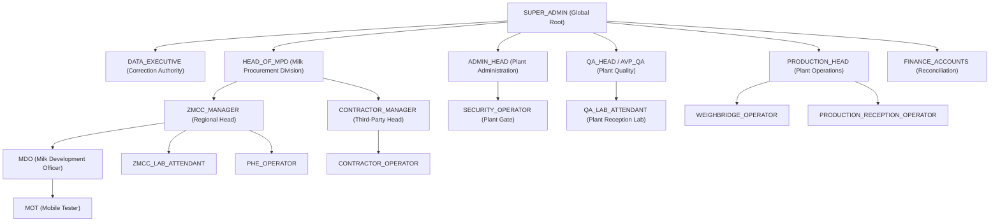
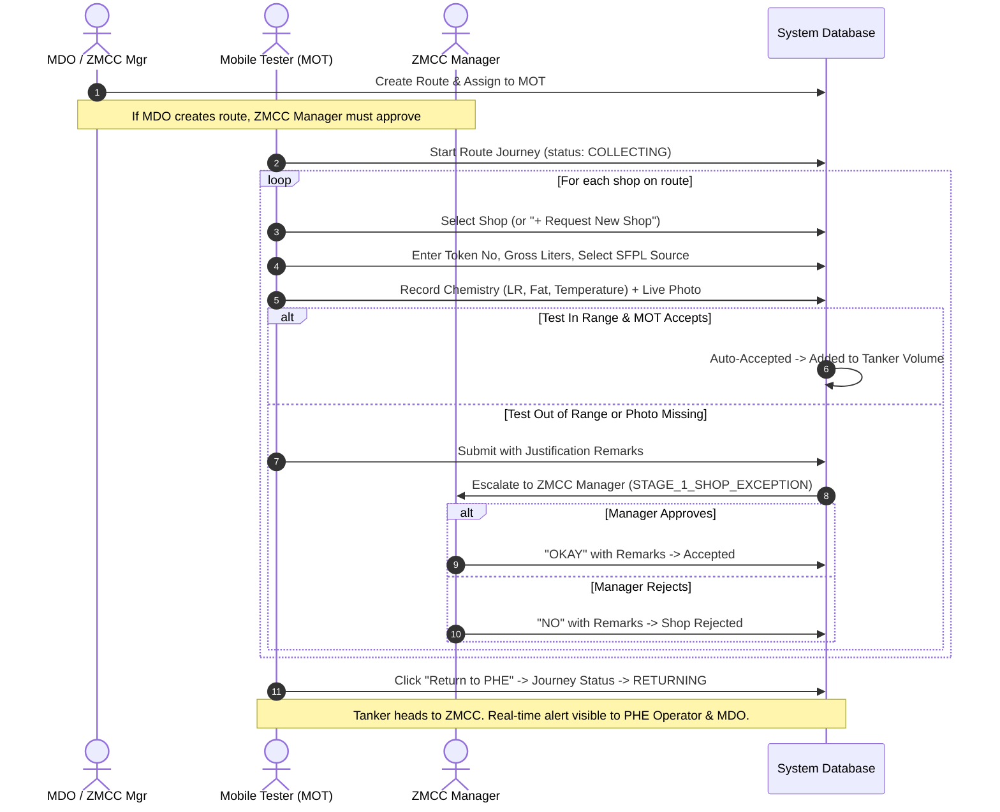
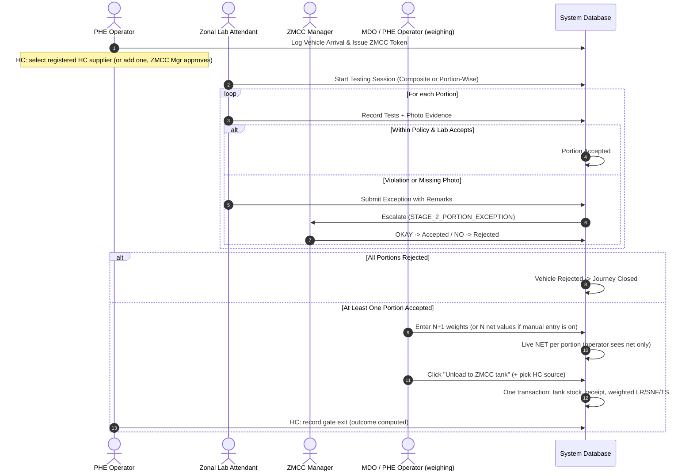
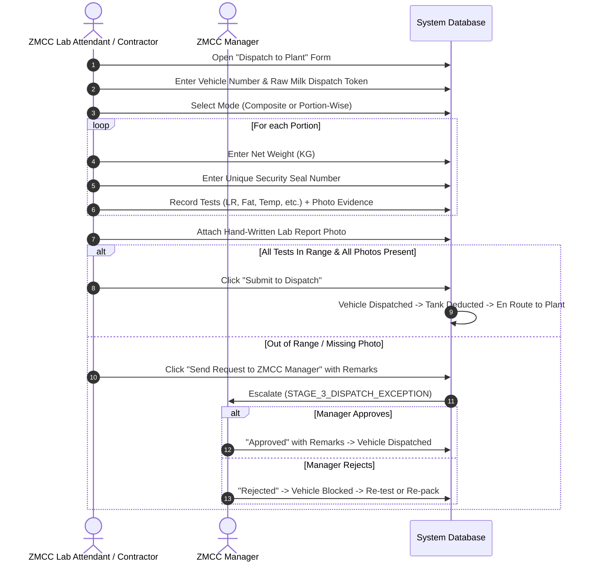
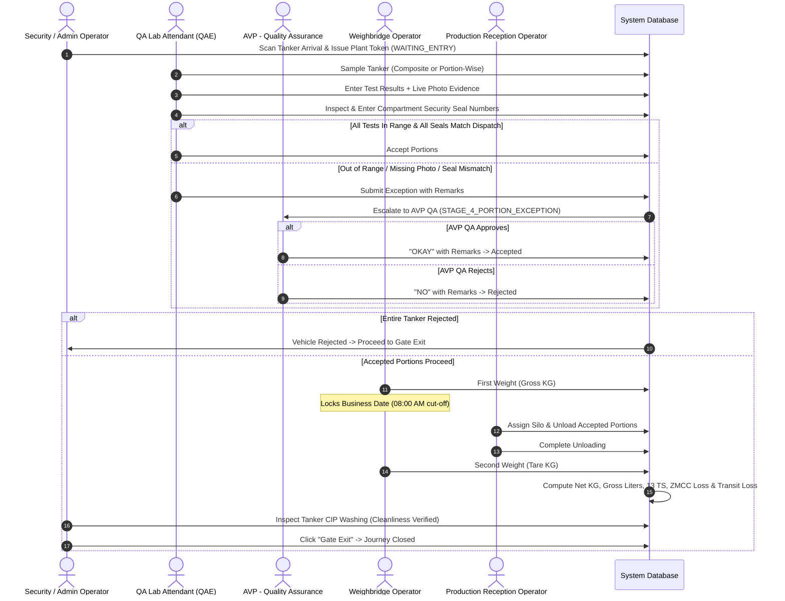
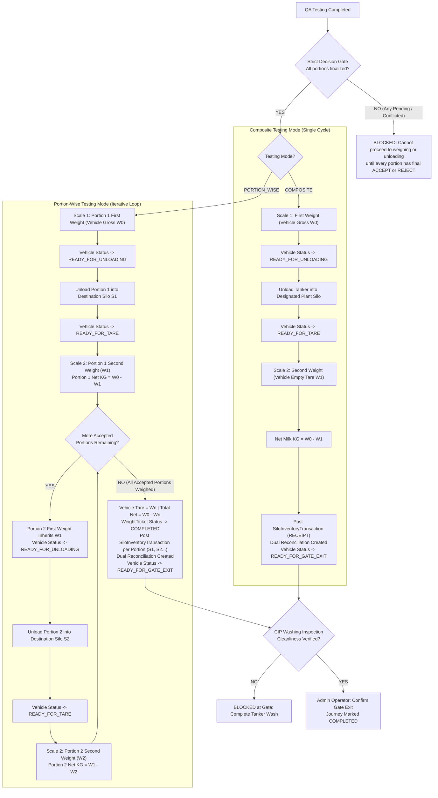

# Complete Milk Reception System Workflow Specification & Implementation Blueprint

> **Master Reference Document for Whole System Implementation & UI/UX Alignment**  
> **File Location:** `docs/COMPLETE_SYSTEM_WORKFLOW_SPECIFICATION.md`  
> **Target Version:** Shakarganj Food Products Limited (SFPL) Milk Reception System 2.0  
> **Last Updated:** October 2026

---

## Table of Contents
1. [System Architecture & Core Philosophy](#1-system-architecture--core-philosophy)
2. [User Roles, Hierarchy & Scoping](#2-user-roles-hierarchy--scoping)
3. [The 4 Operational Stages (End-to-End Workflow)](#3-the-4-operational-stages-end-to-end-workflow)
   - [Stage 1: Area Milk Collection (MOT & Field)](#stage-1-area-milk-collection-mot--field)
   - [Stage 2: HC & MC Reception at ZMCC](#stage-2-hc--mc-reception-at-zmcc)
   - [Stage 3: ZMCC & Contractor Dispatch to Plant](#stage-3-zmcc--contractor-dispatch-to-plant)
   - [Stage 4: Plant Reception (Gate to Silo)](#stage-4-plant-reception-gate-to-silo)
4. [Universal Decision & Escalation Matrix](#4-universal-decision--escalation-matrix)
5. [Milk Source Onboarding & HC Allocation Rules](#5-milk-source-onboarding--hc-allocation-rules)
6. [Mathematical Formulas & Automated Calculations](#6-mathematical-formulas--automated-calculations)
7. [Photo Evidence, Offline Mode & Security Seals](#7-photo-evidence-offline-mode--security-seals)
8. [Governance, Corrections & Segregation of Duties](#8-governance-corrections--segregation-of-duties)
9. [Complete Screen Inventory, URL Map & Navigation Structure](#9-complete-screen-inventory-url-map--navigation-structure)
10. [UI/UX Implementation Standards](#10-uiux-implementation-standards)

---

## 1. System Architecture & Core Philosophy

The SFPL Milk Reception Application digitizes the procurement of raw milk from individual village dairy shops, direct HC suppliers, and third-party contractors through regional ZMCC collection centers and long-haul tankers into the processing plant silos.

```
+---------------------------------------------------------------------------------------------------+
|                                 END-TO-END SUPPLY CHAIN PIPELINE                                   |
|                                                                                                   |
|  [STAGE 1: Field]      -->  [STAGE 2: ZMCC Intake]  -->  [STAGE 3: Dispatch]  -->  [STAGE 4: Plant] |
|  - MOT Route Shops          - PHE Token Arrival          - Tanker Sampling         - Plant Gate Token |
|  - Density & Chemistry      - Physical Lab Testing       - Security Seals          - QA Lab Testing   |
|  - Shop Receipt Token       - Portion Weighing Loop:     - Lab Report Photo        - Weighing Loop:   |
|  - Source Selection           1st Wt -> Tank -> 2nd Wt   - Manager Approval          Composite: 1x    |
|  - MOT Loss / Gain          - ZMCC Storage Tank          - Auto Gross L / 13 TS      Portion-Wise: Nx |
|                             - Area Loss / Gain                                     - Silo Unloading   |
|                                                                                    - CIP Wash & Exit  |
+---------------------------------------------------------------------------------------------------+
```

### Core Architecture Pillars:
1. **Zero Data Loss & Strict Concurrency:** Every record uses integer version concurrency checks (`version: { increment: 1 }`).
2. **Immutable Audit Trail:** Every business decision, exception review, weight capture, and photo upload writes an append-only row to `AuditLog`.
3. **No Dead Ends / Minimalist UI:** Pages are uncluttered and concise. Tab navigation is synchronized with the URL query string (`?tab=...`), backed by TanStack Query caches so tab switches are instant without screen blinking or page reloads.
4. **Segregation of Duties (SoD):** A user can never approve their own submission. Superiors can act in delegation within their regional scope, but self-approval requires independent super-admin justification.

---

## 2. User Roles, Hierarchy & Scoping

The application enforces an explicit 13-role organizational hierarchy across Field, Regional ZMCC, Contractor, Plant, and Executive scopes.



### Role Scopes & Responsibilities:

| Role Code | Role Label | Scope | Primary Workspaces & Responsibilities |
| :--- | :--- | :--- | :--- |
| `SUPER_ADMIN` | Super Administrator | Global | System configuration, SOP rule master, audit explorer, user and device management. |
| `DATA_EXECUTIVE` | Data Executive | Global | Sole authority to execute field corrections and historical record amendments. |
| `HEAD_OF_MPD` | Head of MPD | Regional / MPD | High-level approvals, new ERP milk source authorizations, rejected milk disposition. |
| `ZMCC_MANAGER` | ZMCC Manager | ZMCC-scoped | Approves Stage 1 & 2 exceptions, routes, new HCs; oversees ZMCC intake & dispatch. |
| `MDO` | Milk Development Officer | ZMCC-scoped | Plans & creates routes, manages local field development, shop additions. |
| `MOT` | Mobile Tester | Field / Journey | Tests milk at village shops on route, records shop tokens, uploads photo evidence. |
| `PHE_OPERATOR` | PHE Operator | ZMCC Gate | Logs vehicle arrivals at ZMCC, issues Raw Milk Intake Tokens for MC/HC. |
| `ZMCC_LAB_ATTENDANT` | Zonal Lab Attendant | ZMCC Lab | Tests portions at ZMCC intake, links HC milk sources, executes dispatch to plant. |
| `CONTRACTOR_MANAGER` | Contractor Manager | Contractor | Supervises contractor direct supply, reviews dispatches to plant. |
| `CONTRACTOR_OPERATOR` | Contractor Operator | Contractor | Dispatches contractor tankers to plant with weights, seals, and lab reports. |
| `SECURITY_OPERATOR` | Security Operator | Plant Gate | Issues Plant Entry Tokens, checks CIP tanker washing, logs Gate Exit. |
| `QA_LAB_ATTENDANT` | QAE - Reception Lab | Plant Lab | Samples incoming plant tankers, verifies dispatch seals, enters test results with photos. |
| `QA_HEAD` | AVP - Quality Assurance | Plant QA | Approves plant QA exceptions, seal mismatches, sets plant reception SOP policies. |
| `WEIGHBRIDGE_OPERATOR` | Weighbridge Operator | Weighbridge | Captures First Weight (Gross) and Second Weight (Tare) in KG; locks Business Date. |
| `PRODUCTION_RECEPTION_OPERATOR` | Production Operator | Plant Silos | Connects tanker hoses, unloads accepted milk to plant silos between weighings. |
| `FINANCE_ACCOUNTS` | Finance & Accounts | Plant Finance | Reconciles purchase quantities against plant received, tracks area and transit losses. |

---

## 3. The 4 Operational Stages (End-to-End Workflow)

---

### Stage 1: Area Milk Collection (MOT & Field)

Stage 1 covers mobile milk testing and collection at village dairy shops before the milk reaches the regional chilling center.



#### Detailed Stage 1 Rules:
1. **Route Management:**
   - Routes belong to a specific ZMCC.
   - If created by an MDO, the route requires ZMCC Manager approval (`STAGE_1_NEW_ROUTE`) before assignment.
   - The MOT cannot start an unassigned or pending route.
2. **Shop Visits:**
   - MOT processes shops sequentially.
   - If a new shop appears in the field, MOT clicks **Add New Shop**. The request is escalated to ZMCC Manager / MDO for approval (`STAGE_1_NEW_SHOP`).
3. **Data Captured at Each Shop:**
   - Physical Raw Milk Receipt Note Token Number.
   - Gross Liters measured at shop.
   - Milk Source (name only, selected from the dropdown of sources assigned to the ZMCC). **Required on every collection.** There is no source request: sources are created and assigned only by MPD Head, Super Admin and Data Executive.
   - Chemistry metrics (LR, Fat, Temperature, Acidity) with live camera photo evidence.
4. **Calculations at Shop Completion:**
   - Total solids: $13\text{ TS} = \frac{\text{Net KG} \times \text{TS}\%}{13}$
   - Shop status transitions to `COMPLETED` or `REJECTED`.
5. **Return to PHE & Journey Lifecycle:**
   - **Trigger:** When all shops on the route are completed (or if collection concludes early due to tanker capacity or field conditions), the MOT taps the **"Return to PHE"** button in `JourneyCard` or `ReceiptModal`.
   - **Confirmation Modal:** Displays a summary of total shops (assigned, visited, skipped, rejected, pending) and collected volume (Gross L & @13TS L). If unvisited shops remain, an operational warning is shown.
   - **Status Transition:** The journey transitions from `COLLECTING` to `RETURNING`. A "Resume Collection" option is available if additional milk must be recorded prior to reaching the gate.
   - **PHE / MDO Incoming Visibility:** The vehicle appears immediately on the ZMCC intake panel (`/phe`) under **"Incoming / Returning to ZMCC (En Route)"**, allowing the PHE Operator and MDO to track incoming vehicles, driver, route, and milk volume before gate arrival.
   - **Arrival Completion:** When the tanker reaches the ZMCC gate, the PHE Operator / MDO logs the arrival and issues the sequential ZMCC Token, transitioning the journey to `COMPLETED` and closing Stage 1.

---

### Stage 2: HC & MC Reception at ZMCC

Stage 2 covers arrival, physical chemistry testing, milk source allocation, weighing, and storage in regional ZMCC tanks for both Mobile Collection (MC) and Head Can / Direct Supplier (HC) deliveries.



#### Detailed Stage 2 Rules:
1. **Intake Arrival Logging (PHE):**
   - The PHE Operator and MDO monitor incoming vehicles in real time on the ZMCC intake panel (`/phe`), where tankers marked `RETURNING TO PHE` are prioritized at the top under "Incoming / Returning to ZMCC (En Route)".
   - When the vehicle enters ZMCC gate, PHE Operator / MDO verifies vehicle number, driver name, phone, arrival time, and issues sequential ZMCC Token.
   - For MOT arrivals (`MOT`): Linked to the active Journey from Stage 1 (transitions journey status from `RETURNING` to `COMPLETED`).
   - For HC Arrivals (`HC`): PHE Operator selects registered HC supplier. If new, registers details and requests ZMCC Manager approval (`STAGE_2_NEW_HC`). All direct supplier deliveries are standardized under the unified **HC** nomenclature.
2. **Laboratory Testing Mode:**
   - **Composite:** Single bulk sample representing the entire vehicle (1 portion).
   - **Portion-Wise:** Multi-can or multi-compartment testing (2+ portions).
3. **HC Milk Source (chosen at unload, not at the lab):**
   - The lab never asks for a source. Rejected milk never has a source.
   - A source is the **ledger account the milk quantity is credited to**. It is independent of shops, routes and suppliers.
   - After the whole vehicle is weighed and the MDO / PHE Operator clicks **"Unload to ZMCC tank"**, one source (name only, from the sources assigned to that ZMCC) is picked for the whole HC vehicle. It is stored with name and code snapshot on the tank receipt and mirrored onto the HC arrival.
   - MC milk takes its source from each shop collection (required at every collection); no source is asked at unload.
4. **ZMCC Weighing & Unload (vehicle level, MDO / PHE Operator):**
   - Only vehicles ready for weighing (all portions finally decided, at least one accepted, not yet unloaded) appear as cards. Tapping a card opens a Drawer (mobile) / modal (desktop).
   - **Weight mode:** for N accepted portions the operator enters N+1 weights, each smaller than the one before. Net of portion k = weight k minus weight k+1.
   - **Manual mode:** only when Super Admin turns on the global *ZMCC weighing policy* and only in the allowed unit(s) (KG, LITER or both). The operator types each portion's net; litres are converted with the portion density. One mode per vehicle.
   - The operator sees **net only** (kg or the typed unit): never gross litres, 13 TS litres, LR, SNF or TS. Those figures are shown to ZMCC Manager and above.
   - Saving values books nothing. **"Unload to ZMCC tank"** (tank, plus source for HC) runs one transaction: capacity check, tank stock (gross litres and 13 TS litres), and the receipt with LR / Fat / SNF / TS / density weighted by net weight.
   - Area Loss / Gain = ZMCC **received** net KG minus MC shop recorded net KG. Accepted-but-not-received milk is shown next to it, not hidden.
   - Corrections after unload: Data Executive and Super Admin only.
5. **Exit (HC) and closing without unloading (MC and HC):**
   - MC has no gate exit: the MC journey is COMPLETED at arrival and the company vehicle is free once its last arrival is finished (all unloaded, all rejected, or closed without unloading).
   - HC: the PHE Operator records the gate exit as the last step. The outcome is computed, never typed: RECEIVED, REJECTED, PARTLY_RECEIVED, ACCEPTED_NOT_RECEIVED.
   - If accepted milk was not unloaded, a reason (LEFT_BEFORE_UNLOADING, SENT_BACK, TANK_FULL, VEHICLE_PROBLEM, OTHER) and remarks (min 3 letters) are required, and the ZMCC Manager is notified.
   - **Close without unloading:** PHE Operator requests with reason and remarks, ZMCC Manager approves. The arrival closes with reason CLOSED_WITHOUT_UNLOADING.
   - Reports: ZMCC Manager "left without full unloading" list; MPD Head overview and governance exceptions per ZMCC; vehicle-stages category "Exited without receipt" (separate from Rejected).

---

### Stage 3: ZMCC & Contractor Dispatch to Plant

Stage 3 governs the loading and dispatch of bulk milk tankers from ZMCC chilling centers or third-party contractor facilities to the main processing plant.



#### Detailed Stage 3 Rules:
1. **Dispatch Actors:**
   - For ZMCC tankers: Completed by `ZMCC_LAB_ATTENDANT`.
   - For Contractor tankers: Completed by `CONTRACTOR_OPERATOR` (chemistry tests are optional for contractors, but weight, seals, and lab report photo are compulsory).
2. **Security Seal Tracking:**
   - Every compartment/portion must receive a unique physical tamper-evident seal number.
   - Seal numbers are stored in the database snapshot to be verified at the plant gate.
3. **Compulsory Dispatch Evidence:**
   - Live photo for each required test result.
   - Hand-written physical laboratory report photo.
4. **Tank Deduction:**
   - Upon successful dispatch submission, the dispatched gross liters are deducted from the ZMCC storage tank inventory.

---

### Stage 4: Plant Reception (Gate to Silo)

Stage 4 covers plant gate arrival, quality assurance testing, seal verification, weighbridge gross/tare weighing, silo unloading, and tanker CIP washing before gate exit.



#### Detailed Stage 4 Rules:
1. **Plant Gate Token:**
   - Security Operator records arrival timestamp, vehicle number, driver license, and assigns a sequential Plant Token.
2. **Quality Testing & Seal Verification:**
   - QA Reception Lab tests milk against Plant Reception SOP rules.
   - **Seal Verification:** Compares the entered seal numbers against the Stage 3 dispatch seal numbers.
   - If any seal is mismatched or broken, or if any test metric violates plant SOP, the portion **cannot be accepted locally** and is escalated to `AVP_QA` (`STAGE_4_PORTION_EXCEPTION`).
3. **Composite Failure Rule:**
   - If a composite (whole tanker) test fails and is rejected by QA / AVP, **the entire vehicle is rejected immediately**.
4. **Weighbridge & Business Date Locking:**
   - **First Weight (Gross KG):** Records total vehicle weight with milk on Scale 1.
   - **Business Date Calculation:** Locked strictly once at the vehicle's initial First Weight:
     - Timestamp `00:00:00` to `07:59:59`: Attributed to the **previous calendar date**.
     - Timestamp `08:00:00` to `23:59:59`: Attributed to the **current calendar date**.
     - All subsequent portion cycles retain this locked operational business date.
5. **Weighing & Unloading Execution Models:**
   - **Model A: Composite Test Mode (Single Vehicle Cycle):**
     1. Weighbridge records initial **First Weight (Gross KG)** for the entire tanker.
     2. Production Operator connects hoses and unloads all compartments into the designated active silo(s). Status becomes `UNLOADED`.
     3. Weighbridge records final **Second Weight (Tare KG)** of the empty tanker.
     4. System posts final `SiloInventoryTransaction` (Receipt) and executes Dual Reconciliation.
   - **Model B: Portion-Wise Test Mode (Iterative Loop Per Accepted Portion):**
     - For tankers with multiple accepted compartments ($P_1, P_2, \dots, P_N$):
     1. **Portion 1:** Weighbridge records Gross Weight $W_{\text{gross}, 1}$. Production unloads Portion 1 into Silo $S_1$. Weighbridge records Second Weight $W_{\text{tare}, 1}$. $\text{Net KG}_1 = W_{\text{gross}, 1} - W_{\text{tare}, 1}$. System immediately posts inventory receipt to Silo $S_1$.
     2. **Portion $i$ ($i > 1$):** First Weight $W_{\text{gross}, i} = W_{\text{tare}, i-1}$. Production unloads Portion $i$ into Silo $S_i$. Weighbridge records Second Weight $W_{\text{tare}, i}$. $\text{Net KG}_i = W_{\text{gross}, i} - W_{\text{tare}, i}$. Inventory receipt posted to Silo $S_i$.
     3. **Repeat:** The cycle repeats until every accepted portion is weighed and unloaded.
     4. **Multi-Silo Compatibility:** Because each portion generates its own audited receipt into its specific destination silo, multi-silo tankers never trigger allocation deadlocks.


6. **Loss / Gain & Quality Aggregation:**
   - $\text{Total Received Net KG} = \sum_{i=1}^N \text{Net KG}_i$.
   - **Weighted 13 TS:** Calculated using mass-weighted average quality across all accepted portions ($\bar{\text{LR}}$, $\bar{\text{Fat}}$), ensuring larger compartments have proportionately greater weight.
   - **ZMCC Loss / Gain:** Dispatched Net KG vs. Total Plant Received Net KG.
   - **Transit Loss / Gain:** Original Procurement Net KG vs. Total Plant Received Net KG.
7. **Tanker Cleanliness & Gate Exit:**
   - Following final tare weighing, tanker proceeds to CIP (Clean-in-Place) washing station.
   - Security Operator verifies tanker washing status (`tanker_washed === true`) and clicks **Gate Exit**. The vehicle journey is marked `COMPLETED`.
   - Gate exit is strictly blocked if tanker washing inspection has not been confirmed.

---

## 4. Universal Decision & Escalation Matrix

Across all 4 stages, the exact same deterministic decision matrix applies:

| System SOP Evaluation | Operator Verdict | Photo Evidence | Automated Workflow Route | Required Approver |
| :---: | :---: | :---: | :--- | :--- |
| **PASS** | **ACCEPT** | Complete | **AUTO_ACCEPT** $\rightarrow$ Proceeds directly to next step | None |
| **FAIL** | **REJECT** | Any | **DIRECT_REJECT** $\rightarrow$ Shop closed / Portion rejected | None (Remarks required) |
| **FAIL** | **ACCEPT** | Complete | **SEND_TO_APPROVER** $\rightarrow$ Escalated | **Stage Manager** |
| **PASS** | **REJECT** | Complete | **SEND_TO_APPROVER** $\rightarrow$ Escalated | **Stage Manager** |
| **Any** | **Any** | **Missing** | **SEND_TO_APPROVER** $\rightarrow$ Escalated | **Stage Manager** |

### Stage Approver Assignment:
- **Stage 1 (Shop Collection):** $\rightarrow$ `ZMCC_MANAGER`
- **Stage 2 (ZMCC Intake & Portions):** $\rightarrow$ `ZMCC_MANAGER`
- **Stage 3 (Dispatch Exceptions):** $\rightarrow$ `ZMCC_MANAGER`
- **Stage 4 (Plant QA & Seal Mismatches):** $\rightarrow$ `QA_HEAD` / `AVP_QA`
- **New Source / ERP Mapping Requests:** $\rightarrow$ `HEAD_OF_MPD`
- **Rejected Milk Disposition:** $\rightarrow$ `HEAD_OF_MPD` / `QA_HEAD`

---

## 5. Milk Sources, Contractors & ERP Codes

A **milk source** is the ledger account that milk quantity is credited to (a person or party in the ERP). It has a name and an ERP code and is independent of shops, routes and suppliers.

1. **Who manages sources:** only `HEAD_OF_MPD`, `SUPER_ADMIN` and `DATA_EXECUTIVE`. They create, edit, deactivate and assign a source to one or more ZMCCs (the dropdown at a ZMCC shows only sources assigned to it). Their screen is the Sources tab (`/mpd/head?tab=SOURCES`). **Nobody requests sources**; the request flow does not exist.
2. **Who sees what:** ZMCC Manager, MDO, PHE Operator, Lab Attendant see source **names only**. The ERP code is returned by the API and shown only to the three owner roles and to reporting roles (MPD Head, Data Executive, Data Analyst, Super Admin).
3. **Where a source is chosen:**
   - **MC:** at every shop collection (required; backend rejects a collection without one). Shops carry no source.
   - **HC:** once per vehicle at "Unload to ZMCC tank" (Stage 2). Not at HC registration, arrival or lab accept. HC suppliers carry no ERP reference.
4. **Direct plant contractors** (milk goes straight to the plant) are procurement sources of type CONTRACTOR. Their **ERP code is required when the contractor is added** on Super Admin > Procurement Sources (the page where ZMCCs and contractors are added), and is editable later only by the three owner roles. There is no source dropdown in contractor flows; the contractor is its own ledger account.
5. **Naming:** arrivals are only **MC** (company collection vehicle) and **HC**. "Local supplier" and the ZMCC-side "contractor arrival" no longer exist.

---

## 6. Mathematical Formulas & Automated Calculations

All mathematical calculations are performed deterministically on the server side in `src/backend/utils/milkFormulas.ts`.

### 1. Corrected Lactometer Reading (CLR)
$$\text{CLR} = \text{Observed LR} + 0.2 \times (\text{Observed Temp }^\circ\text{C} - 20)$$

### 2. Milk Specific Gravity / Density ($\rho$)
$$\rho = 1 + \left(\frac{\text{CLR}}{\text{CLR} + 1000}\right)$$

### 3. Gross Volume in Liters
$$\text{Gross Liters} = \frac{\text{Net Weight (KG)}}{\rho}$$

### 4. Total Solids (TS %) & 13 TS Equivalent
$$\text{SNF}\% = \left(\frac{\text{CLR}}{4}\right) + (0.22 \times \text{Fat}\%) + 0.72$$
$$\text{TS}\% = \text{Fat}\% + \text{SNF}\%$$
$$13\text{ TS (Liters)} = \text{Gross Liters} \times \frac{\text{TS}\%}{13}$$

#### Multi-Portion Volume-Weighted Quality Basis
When a vehicle contains multiple accepted portions ($P_1, \dots, P_N$), quality metrics are weighted by each portion's measured Net Weight:
$$\bar{\text{LR}} = \frac{\sum_{i=1}^N (\text{Net KG}_i \times \text{LR}_i)}{\sum_{i=1}^N \text{Net KG}_i}, \quad \bar{\text{Fat}} = \frac{\sum_{i=1}^N (\text{Net KG}_i \times \text{Fat}_i)}{\sum_{i=1}^N \text{Net KG}_i}$$
$$\text{Vehicle SNF} = \frac{\bar{\text{LR}}}{4} + (0.22 \times \bar{\text{Fat}}) + 0.72$$
$$\text{Vehicle TS} = \bar{\text{Fat}} + \text{Vehicle SNF}$$
$$\text{Total 13 TS Liters} = \text{Total Gross Liters} \times \frac{\text{Vehicle TS}}{13}$$

### 5. Supply Chain Loss & Gain Metrics
$$\text{Area Loss / Gain (KG)} = \text{ZMCC Accepted Net KG} - \text{MOT Shop Recorded Net KG}$$
$$\text{ZMCC Loss / Gain (KG)} = \text{Plant Received Net KG} - \text{ZMCC Dispatched Net KG}$$
$$\text{Transit Loss / Gain (KG)} = \text{Plant Received Net KG} - \text{Initial Procured Net KG}$$

---

## 7. Photo Evidence, Offline Mode & Security Seals

1. **Compulsory Photographic Evidence:**
   - Any test marked `photo_compulsory = true` in the active policy requires a valid image upload before submission.
   - Each photo metadata embeds: `captureId`, SHA-256 hash, GPS coordinates (latitude/longitude/accuracy), device capture timestamp, user code, role, and token.
2. **Hand-Written Lab Report Photo:**
   - Mandatory at Stage 3 dispatch for ZMCC and contractor dispatches.
3. **Security Seals (Stage 3 & Stage 4):**
   - Each compartment has an alphanumeric seal code.
   - Stage 4 QAE enters verified seals; system checks exact string equality against dispatch snapshot.
   - Any seal discrepancy triggers automated escalation to AVP QA.
4. **Offline Capability (Field Android PWA):**
   - MOT field collection works offline.
   - Local actions append to an indexed IndexedDB ledger.
   - When connectivity resumes, events sync in ordered batches with idempotency keys (`clientUuid`).

---

## 8. Governance, Corrections & Segregation of Duties

1. **Segregation of Duties (SoD):**
   - An actor cannot approve an exception on a record they created or tested.
   - Attempting self-approval returns `403 Forbidden: Segregation of duties applies`.
2. **Correction Authority (Data Executive & Super Admin Only):**
   - Operational users cannot edit historical completed records.
   - Operators can click **"Request Correction"**, specifying field, current value, proposed value, and justification.
   - The correction request routes to the **Data Executive** desk.
   - Only `DATA_EXECUTIVE` and `SUPER_ADMIN` have the cryptographic authorization to apply direct database corrections.
   - Every correction generates a `CORRECTION_APPLIED` audit event capturing before/after values and actor identity.
   - **Tickets:** "Request Correction" is a ticket (record, wrong value, proposed value, reason). The requester sees its status (Open, Approved, Rejected, Done). Tickets cover MC, HC, weighing and exit records.
   - **No counts below Data Executive:** lower roles never see correction counters, "n/5" badges or correct buttons. Data Executive and Super Admin correct without a limit.
6. **Fleet:** company vehicles are created, edited, deactivated and transferred only by Data Executive and Super Admin (Fleet screen). MDO / ZMCC Manager pick only registered, active, available vehicles.

---

## 9. Complete Screen Inventory, URL Map & Navigation Structure

All routes are mounted under standard Next.js layout structures with synchronized sidebar navigation:

| URL Route | Primary Role | Tab Query Params | Screen Name & Purpose |
| :--- | :--- | :--- | :--- |
| `/mot` | `MOT` | `?tab=routes`, `?tab=shop`, `?tab=history` | **MOT Field Station:** Route selection, shop sampling, receipt note issuing. |
| `/zmcc/arrivals` | `PHE_OPERATOR` | `?tab=mot`, `?tab=hc`, `?tab=inside`, `?tab=history` | **ZMCC Gate Reception:** Log arrivals, issue intake tokens, register new HCs. |
| `/zmcc/lab` | `ZMCC_LAB_ATTENDANT` | `?tab=queue`, `?tab=testing`, `?tab=history` | **ZMCC Lab Desk:** Queue of arrivals, portion testing, source allocation, test history. |
| `/zmcc/weighing` | `ZMCC_LAB_ATTENDANT` / `PHE_OPERATOR` | `?tab=weighing`, `?tab=history` | **ZMCC Weighing:** First (Gross) & Second (Tare) weight capture per accepted portion, active ZMCC tank assignment and loading. |
| `/zmcc/dispatch` | `ZMCC_LAB_ATTENDANT` | `?tab=new`, `?tab=history` | **ZMCC Dispatch Desk:** Seal assignment, dispatch testing, hand-written report photo. |
| `/contractor/dispatch`| `CONTRACTOR_OPERATOR`| `?tab=dispatch`, `?tab=history` | **Contractor Dispatch:** Third-party dispatch to plant with weights and seals. |
| `/department/security`| `SECURITY_OPERATOR` | `?tab=WAITING_ENTRY`, `?tab=GATE_EXIT`, `?tab=COMPLETED` | **Plant Security Gate:** Issue plant entry tokens, tanker CIP inspection, gate exit. |
| `/department/qa` | `QA_LAB_ATTENDANT` | `?tab=WAITING`, `?tab=IN_PROGRESS`, `?tab=COMPLETED` | **Plant QA Reception Lab:** Tanker sampling, seal verification, chemistry testing. |
| `/department/weighbridge`| `WEIGHBRIDGE_OPERATOR`| `?tab=FIRST_WEIGHT`, `?tab=SECOND_WEIGHT`, `?tab=COMPLETED` | **Plant Weighbridge:** Gross weight (locks business date once), Tare weight per accepted portion (repeated for each accepted portion in portion-wise mode). |
| `/department/production` | `PRODUCTION_RECEPTION_OPERATOR` | `?tab=READY`, `?tab=UNLOADING`, `?tab=COMPLETED` | **Plant Silo Unloading:** Silo destination assignment, hose connection, unloading. |
| `/approvals` | `ZMCC_MANAGER` / `QA_HEAD` / `HEAD_OF_MPD` | `?stage=STAGE_1\|STAGE_2\|STAGE_3\|STAGE_4` | **Unified Approval Inbox:** Universal drawer for deciding exceptions & source onboarding. |
| `/mpd/zmcc-manager` | `ZMCC_MANAGER` | `?tab=OVERVIEW`, `?tab=APPROVALS`, `?tab=HISTORY` | **ZMCC Manager Console:** Regional oversight, route approvals, exception decisions. |
| `/mpd/head` | `HEAD_OF_MPD` | `?tab=OVERVIEW`, `?tab=APPROVALS`, `?tab=SOURCES` | **MPD Head Executive Desk:** Multi-ZMCC oversight, source creation, rejected milk disposition. |
| `/finance/reconciliation` | `FINANCE_ACCOUNTS` | `?tab=reconciliation`, `?tab=sources` | **Finance Desk:** Area & transit loss reconciliation, contractor accounting. |
| `/super-admin/*` | `SUPER_ADMIN` | Configurable | **Super Admin Suite:** SOP policies, test points, audit logs, devices, users, silos. |

---

## 10. UI/UX Implementation Standards

To keep the application responsive, clean, and intuitive across devices:

1. **No Sprawling Long Pages:** Use clean summary cards with compact data tables.
2. **Contextual Action Drawers & Modals:**
   - On mobile screens ($<1024\text{px}$): Contextual forms slide up in bottom **Drawers** (`DrawerContent`).
   - On desktop screens ($\ge 1024\text{px}$): Dialogs render as focused, centered **Modals** (`ModalContent`).
3. **URL-Driven Tab State:**
   - Tabs must never rely on untracked local state. Tab selection is bound to URL search params (`?tab=queue`), allowing direct bookmarks, back-button support, and 100% sync with sidebar links.
4. **Actionable Empty States:**
   - If an active session is not loaded (e.g., in `/zmcc/lab?tab=testing`), do not show a blank screen. Display an immediate action card showing waiting arrivals with **"Start Testing"** buttons.
5. **Color Coding for Quality Status:**
   - Emerald (`bg-emerald-500`, `text-emerald-700`): Passed SOP / Accepted.
   - Rose (`bg-rose-500`, `text-rose-700`): Failed SOP / Rejected.
   - Amber (`bg-amber-500`, `text-amber-700`): Exception / Pending Approver Decision.
   - Violet (`bg-violet-500`, `text-violet-700`): Escalated to Supervisor / Approver.
6. **Form Ergonomics:**
   - Inputs for codes auto-capitalize (`uppercase font-mono`).
   - Rejection buttons require a minimum 5-character justification before enabling submission.
   - Number fields format with tabular figures (`tabular-nums font-semibold`).
7. **Pure Sidebar Navigation (Zero In-Page Tab Clutter):**
   - Big-page tab bars (such as in-page `SegmentedTabs` or duplicate button rows) are completely eliminated.
   - All sub-views and station queues are navigated exclusively via the collapsible `HierarchicalNavDrawer`.
   - Page headers dynamically adapt titles and subtitles based on the URL query state (`?tab=...`), maintaining clean, single-purpose workspaces without vertical or horizontal clutter.
8. **Dynamic Team Station Delegation Navigation:**
   - When an upper-hierarchy user (ZMCC Manager, MPD Head, Super Admin) covers or inspects a subordinate's station (e.g. MOT, PHE, Lab, Weighbridge, Silos), the sidebar dynamically swaps to display that subordinate station's complete operational navigation tree.
   - A prominent pinned "← Return to [Superior Role] Workspace" button appears at the top of the drawer for seamless single-click return.

---

*This document serves as the single source of truth for the Shakarganj Food Products Limited Milk Reception system workflow, screens, roles, and business rules.*
