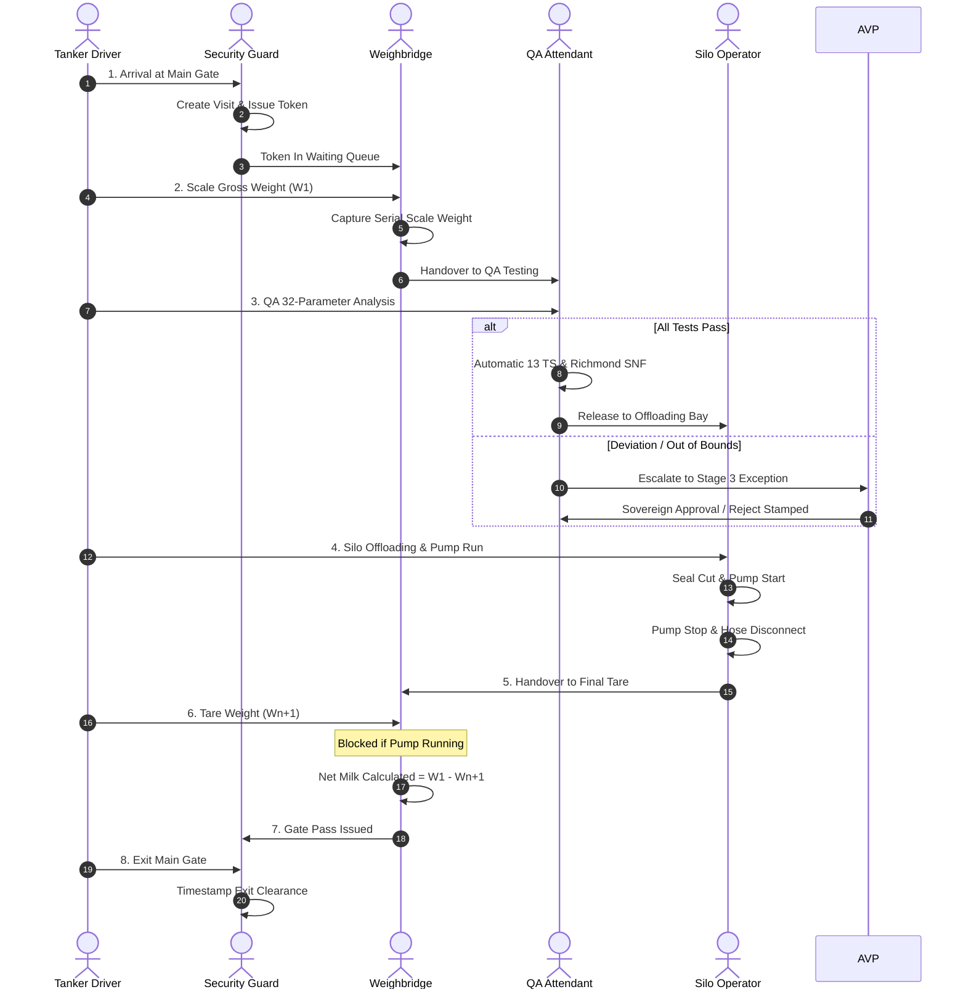

# Graphify System Architecture & Relational Knowledge Graph
*Shakarganj Food Products Ltd. · Dairy Operations & Milk Reception Application*

---

## 1. Domain Ontology & System Nodes

```mermaid
graph TD
    %% ENTITY NODES
    subgraph CoreEntities ["Prisma Data Models & Relational Entities"]
        VV["VehicleVisit"]
        VP["VisitPortion"]
        DI["DispatchInfo"]
        GL["GateLog"]
        WT["WeightTicket"]
        UL["UnloadingLog"]
        AL["AuditLog"]
        SILO["Silo & SiloTransactions"]
        QAS["QATestingSession"]
        PLR["PlantLabResult"]
        ZLS["ZmccLabSession"]
        ZLP["ZmccLabPortion"]
        ZLR["ZmccLabResult"]
        ZAR["ZmccMotArrival / LocalArrival"]
        MJ["MotJourney"]
        MJS["MotJourneyStop"]
        MSC["MotShopCollection"]
        CR["CorrectionRequest"]
        OIR["OperationIdempotencyRecord"]
        FD["FormDraft (Autosave)"]
    end

    %% PHYSICAL PIPELINE STATIONS
    subgraph OperationalPipeline ["Multi-Stage Physical Pipeline"]
        STAGE1["Stage 1: Mobile Tester (MOT) Fleet"]
        STAGE2["Stage 2: ZMCC Intake & PHE Chilling"]
        STAGE3["Stage 3: Plant Security Gate & Weighbridge"]
        STAGE4["Stage 4: Plant QA Analysis & Silo Discharge"]
    end

    %% RELATIONSHIPS
    MJ --> MJS --> MSC
    MSC -->|Rollup & Transit| ZAR
    ZAR --> ZLS --> ZLP --> ZLR
    ZLP -->|Transit Dispatch| DI
    DI --> GL --> VV
    VV --> VP
    VV --> WT
    VP --> QAS --> PLR
    VP --> UL --> SILO
    
    %% GOVERNANCE & RESILIENCE
    CR -.->|Audit Guard| AL
    OIR -.->|Idempotency Protection| VV
    FD -.->|Offline/Crash Draft Recovery| QAS
```

---

## 2. Complete 149-Screen Workspace & Component Catalog

The application UI is structured into modular, unslop-crafted workspaces spanning 19 canonical roles:

### Category A: Public, Onboarding & Gateway (Screens 1–8)
| # | Screen / View | Route / Component | Primary Role | Features & UX Techniques |
|---|---|---|---|---|
| 1 | Mobile Login | `/login` ([`LoginPage.tsx`](file:///c:/MilkReceptionApp/src/frontend/modules/auth/LoginPage.tsx)) | Public / Operator | Mobile optimized form, developer profile selector, nested `rounded-2xl` card |
| 2 | Station Card Login | `/station-login` ([`StationNameCardLogin.tsx`](file:///c:/MilkReceptionApp/src/frontend/modules/auth/StationNameCardLogin.tsx)) | Field Station Operator | Fast badge authentication, numeric PIN pad, touch targets |
| 3 | Device Setup & PWA | `/device-setup` ([`DeviceSetupScreen.tsx`](file:///c:/MilkReceptionApp/src/frontend/modules/pwa/DeviceSetupScreen.tsx)) | Device Operator | Hardware enrollment, camera pairing, persistent token caching |
| 4 | Custom 404 Recovery | `/not-found` ([`not-found.tsx`](file:///c:/MilkReceptionApp/src/app/not-found.tsx)) | Public | Responsive illustration, return button, zero-slop typography |
| 5 | Maintenance Fallback | `/workspace-unavailable` | Public | Graceful downtime recovery screen |
| 6 | Affiliates Network | `/affiliates` ([`affiliates/page.tsx`](file:///c:/MilkReceptionApp/src/app/affiliates/page.tsx)) | Partner / Public | Tier-based indicators (Silver/Gold/Platinum), commission tracker |
| 7 | Partner Onboarding | `/affiliates#apply` | Supplier Partner | Smart validated form capture, immediate toast feedback |
| 8 | Referrals Engine | `/referrals` ([`referrals/page.tsx`](file:///c:/MilkReceptionApp/src/app/referrals/page.tsx)) | Supplier / Transporter | Referral code generator, one-click clipboard sharing |

### Category B: Plant Gate & Security Reception (Screens 9–18)
| # | Screen / View | Route / Component | Primary Role | Features & UX Techniques |
|---|---|---|---|---|
| 9 | Security Gateway Workspace | `/security-gate` ([`SecurityGatewayWorkspace.tsx`](file:///c:/MilkReceptionApp/src/frontend/modules/dashboard/SecurityGatewayWorkspace.tsx)) | `SECURITY_OPERATOR` | Responsive mobile drawer, live token generation, vehicle queue |
| 10 | Waiting Entry Queue | `SecurityGatewayWorkspace` $\to$ Queue Tab | `SECURITY_OPERATOR` | Instant optimistic entry confirmation, status badges |
| 11 | Direct Dispatch Check-in | Modal in Security Workspace | `SECURITY_OPERATOR` | Direct driver registration, tanker seal inspection |
| 12 | Exit Clearance Station | `SecurityGatewayWorkspace` $\to$ Exit Tab | `SECURITY_OPERATOR` | Final gate pass verification, seal cut confirmation |
| 13 | Token Search & Scanner | Search header in Security Gate | `SECURITY_OPERATOR` | Debounced filter, quick barcode scanner trigger |
| 14 | Security Operations Feed | Audit sidebar in Security Gate | `SECURITY_OPERATOR` | Real-time entry/exit activity cards |
| 15 | Unsent Work Logout Guard | [`UnsentWorkLogoutDialog.tsx`](file:///c:/MilkReceptionApp/src/frontend/modules/auth/UnsentWorkLogoutDialog.tsx) | Any Operator | Destructive action protection against losing offline queues |
| 16 | Network Connectivity Banner | [`NetworkStatusBar.tsx`](file:///c:/MilkReceptionApp/src/components/ui/NetworkStatusBar.tsx) | System | Tactile online/offline sync status pill |
| 17 | Department Security View | `/department/security` | `SECURITY_HEAD` | Executive shift overview and security supervisor log |
| 18 | Gate Pass Print Modal | Print overlay in Security Gate | `SECURITY_OPERATOR` | Clean print-friendly CSS ticket output |

### Category C: Plant Weighbridge Station (Screens 19–30)
| # | Screen / View | Route / Component | Primary Role | Features & UX Techniques |
|---|---|---|---|---|
| 19 | Unified Weighbridge Workspace | `/weighbridge` ([`WeighbridgeUnifiedStation.tsx`](file:///c:/MilkReceptionApp/src/frontend/modules/dashboard/WeighbridgeUnifiedStation.tsx)) | `WEIGHBRIDGE_OPERATOR` | Progressive $N+1$ weighing sequence, card stack |
| 20 | First Weight (Gross W1) | [`WeighbridgeFirstWeightPanel.tsx`](file:///c:/MilkReceptionApp/src/frontend/modules/dashboard/WeighbridgeFirstWeightPanel.tsx)) | `WEIGHBRIDGE_OPERATOR` | Live scale serial reading, scale descending guard |
| 21 | Intermediate Weights (W2..Wn) | Progressive weight drawer | `WEIGHBRIDGE_OPERATOR` | Multi-compartment sequential weighing for accepted portions |
| 22 | Final Tare Weight (Wn+1) | [`WeighbridgeSecondWeightPanel.tsx`](file:///c:/MilkReceptionApp/src/frontend/modules/dashboard/WeighbridgeSecondWeightPanel.tsx)) | `WEIGHBRIDGE_OPERATOR` | Net milk calculation ($W_1 - W_{n+1}$), tare safeguard |
| 23 | Manual Scale Override Dialog | Weight override modal | `WEIGHBRIDGE_OPERATOR` | Destructive action confirmation, mandatory justification remarks |
| 24 | Weighbridge Pager & Table | [`Pager.tsx`](file:///c:/MilkReceptionApp/src/frontend/modules/dashboard/components/Pager.tsx) integration | `WEIGHBRIDGE_OPERATOR` | Reusable data table, search debouncing, export CSV |
| 25 | Active Offloading Blocker | Weighbridge status badge | `WEIGHBRIDGE_OPERATOR` | Tare blocked until silo `pump_end_timestamp` is logged |
| 26 | Daily Weight Reconciliation | Scale summary card | `WEIGHBRIDGE_OPERATOR` | Daily tonnage tally and net intake statistics |
| 27 | Department Weighbridge View | `/department/weighbridge` | `WEIGHBRIDGE_HEAD` | Station throughput analytics and scale calibration logs |
| 28 | Scale Calibration Status Card | Scale diagnostics widget | `WEIGHBRIDGE_OPERATOR` | Real-time scale zero-balance and drift monitoring |
| 29 | Weight Ticket Preview Sheet | Ticket drawer | `WEIGHBRIDGE_OPERATOR` | Verified 3-decimal gross/tare/net certification |
| 30 | Multi-Compartment Weight Card | Progressive weighing summary | `WEIGHBRIDGE_OPERATOR` | Per-portion net kg allocation and density conversion |

### Category D: Plant QA Laboratory (Screens 31–48)
| # | Screen / View | Route / Component | Primary Role | Features & UX Techniques |
|---|---|---|---|---|
| 31 | QA Testing Section | `/qa-testing` ([`QATestingSection.tsx`](file:///c:/MilkReceptionApp/src/frontend/modules/dashboard/qa/QATestingSection.tsx)) | `QA_LAB_ATTENDANT` | Multi-tab portion queue (Waiting, In Testing, On Hold) |
| 32 | QA Queue Panel | [`QAQueuePanel.tsx`](file:///c:/MilkReceptionApp/src/frontend/modules/dashboard/qa/QAQueuePanel.tsx) | `QA_LAB_ATTENDANT` | Visual tanker cards with compartment counts and transit tags |
| 33 | Active Test Entry Sheet | [`QATestDrawer.tsx`](file:///c:/MilkReceptionApp/src/frontend/modules/dashboard/qa/QATestDrawer.tsx) | `QA_LAB_ATTENDANT` | 32-parameter input sheet, autosave via `useLocalFormDraft` |
| 34 | Auto Richmond SNF & 13 TS | Dynamic formula calculator | `QA_LAB_ATTENDANT` | Instant calculation: $\text{SNF} = \frac{\text{LR}}{4} + 0.22 \times \text{Fat} + 0.72$ |
| 35 | Qualitative Test Radio Group | [`QualitativeResultRadioGroup.tsx`](file:///c:/MilkReceptionApp/src/frontend/modules/shared/QualitativeResultRadioGroup.tsx) | `QA_LAB_ATTENDANT` | PASS / FAIL / SUSPECT touch buttons with color tokens |
| 36 | 3-Zone SOP Threshold Alert | Live parameter validator | `QA_LAB_ATTENDANT` | Normal (Green), Warning (Amber Hold), Reject (Red) |
| 37 | Stage 3 QA Exception Modal | [`QADecisionModals.tsx`](file:///c:/MilkReceptionApp/src/frontend/modules/dashboard/qa/QADecisionModals.tsx) | `QA_LAB_ATTENDANT` | Escalation to AVP QA with deviation remarks and photos |
| 38 | Photo Evidence Capture Slot | [`PhotoEvidenceSlot.tsx`](file:///c:/MilkReceptionApp/src/frontend/modules/shared/photo/PhotoEvidenceSlot.tsx) | `QA_LAB_ATTENDANT` | Multi-angle photo upload with timestamp watermark |
| 39 | QA Portion Tabs | [`QAPortionTabs.tsx`](file:///c:/MilkReceptionApp/src/frontend/modules/dashboard/qa/QAPortionTabs.tsx) | `QA_LAB_ATTENDANT` | Compartment switching with individual decision states |
| 40 | QA Visit Status Cards | [`QAVisitStatusCards.tsx`](file:///c:/MilkReceptionApp/src/frontend/modules/dashboard/qa/QAVisitStatusCards.tsx) | `QA_LAB_ATTENDANT` | Real-time portion disposition rollup |
| 41 | QA Observation Card | [`QATestObservationCard.tsx`](file:///c:/MilkReceptionApp/src/frontend/modules/dashboard/qa/QATestObservationCard.tsx) | `QA_LAB_ATTENDANT` | Organoleptic smell, taste, appearance quick assessment |
| 42 | Department QA View | `/department/qa` | `QA_HEAD` | Lab quality dashboard, failure rate trends |
| 43 | Department QA Head | `/department/qa-head` | `AVP_QA` | Sovereign decision panel for Stage 3 exceptions |
| 44 | Parameter Deviation Inspector | Modal in QA Station | `QA_LAB_ATTENDANT` | Historical benchmark comparison for suspect supplier |
| 45 | Retest Request Drawer | Retest drawer in QA Station | `QA_LAB_ATTENDANT` | Controlled retest session creation under supervisor seal |
| 46 | Chemical Adulterant Matrix | Sub-panel in QA Test Drawer | `QA_LAB_ATTENDANT` | Urea, formalin, hydrogen peroxide, salt, sugar, starch |
| 47 | Microbiological Quick Card | Sub-panel in QA Test Drawer | `QA_LAB_ATTENDANT` | MBRT, alcohol alizarin, resazurin testing records |
| 48 | QA Shift Handover Sheet | End-of-shift modal | `QA_LAB_ATTENDANT` | Pending sample handover between day and night shifts |

### Category E: Silo Offloading & Production (Screens 49–60)
| # | Screen / View | Route / Component | Primary Role | Features & UX Techniques |
|---|---|---|---|---|
| 49 | Production Unloading Workspace | `/production/unloading` ([`ProductionUnloadingWorkspace.tsx`](file:///c:/MilkReceptionApp/src/frontend/modules/dashboard/ProductionUnloadingWorkspace.tsx)) | `PRODUCTION_RECEPTION_OPERATOR` | Offloading bay selector, live flow rate monitor |
| 50 | Start Unloading Drawer | [`ProductionStartUnloadingDrawer.tsx`](file:///c:/MilkReceptionApp/src/frontend/modules/dashboard/ProductionStartUnloadingDrawer.tsx) | `PRODUCTION_OPERATOR` | Bay lock, hose connection, seal cut verification |
| 51 | Complete Unloading Drawer | [`ProductionCompleteUnloadingDrawer.tsx`](file:///c:/MilkReceptionApp/src/frontend/modules/dashboard/ProductionCompleteUnloadingDrawer.tsx) | `PRODUCTION_OPERATOR` | Pump stop timestamp, pipe air purge confirmation |
| 52 | Production Queue List | [`ProductionQueueList.tsx`](file:///c:/MilkReceptionApp/src/frontend/modules/dashboard/ProductionQueueList.tsx) | `PRODUCTION_OPERATOR` | Tankers cleared by QA awaiting bay assignment |
| 53 | Silo Issue & Divert Drawer | [`ProductionSiloIssueDrawer.tsx`](file:///c:/MilkReceptionApp/src/frontend/modules/dashboard/ProductionSiloIssueDrawer.tsx) | `PRODUCTION_OPERATOR` | Emergency stop, line jam, line divert to buffer tank |
| 54 | Plant Silo Inventory Grid | [`PlantSiloInventoryGrid.tsx`](file:///c:/MilkReceptionApp/src/frontend/modules/dashboard/production/PlantSiloInventoryGrid.tsx) | `PRODUCTION_HEAD` | Real-time silo volume gauges, temperature, CIP state |
| 55 | Production Head Workspace | `/department/production-head` ([`ProductionHeadWorkspace.tsx`](file:///c:/MilkReceptionApp/src/frontend/modules/dashboard/production/ProductionHeadWorkspace.tsx)) | `PRODUCTION_HEAD` | Production throughput, plant loss reconciliation |
| 56 | Team Station Action Cards | [`TeamStationActionCards.tsx`](file:///c:/MilkReceptionApp/src/frontend/modules/dashboard/production/TeamStationActionCards.tsx) | `PRODUCTION_HEAD` | Bay utilization and shift operator assignments |
| 57 | Subordinate Work History Feed | [`SubordinateWorkHistoryFeed.tsx`](file:///c:/MilkReceptionApp/src/frontend/modules/dashboard/production/SubordinateWorkHistoryFeed.tsx) | `PRODUCTION_HEAD` | Immutable operational activity log per bay |
| 58 | Silo CIP Sanitation Tracker | Modal in Silo Inventory | `PRODUCTION_OPERATOR` | Cleaning-In-Place countdown and chemical sterilization log |
| 59 | Bay Maintenance Drawer | Modal in Production Workspace | `PRODUCTION_HEAD` | Bay servicing, pump maintenance lockout |
| 60 | Department Production View | `/department/production` | `PRODUCTION_HEAD` | Daily silo intake vs pasteurizer consumption balance |

### Category F: ZMCC Intake, Chilling & PHE Operations (Screens 61–78)
| # | Screen / View | Route / Component | Primary Role | Features & UX Techniques |
|---|---|---|---|---|
| 61 | ZMCC Arrivals Workspace | `/zmcc/reception` ([`ZmccArrivalsWorkspace.tsx`](file:///c:/MilkReceptionApp/src/frontend/modules/zmcc/arrivals/ZmccArrivalsWorkspace.tsx)) | `PHE_OPERATOR` | MC (Milk Collection) & HC (Direct) arrival logging |
| 62 | Milk Collection (MC) Arrival | [`McArrivalPanel.tsx`](file:///c:/MilkReceptionApp/src/frontend/modules/zmcc/arrivals/McArrivalPanel.tsx) | `PHE_OPERATOR` | MOT journey link, vehicle registration, gross intake |
| 63 | Direct Supplier (HC) Arrival | [`HcArrivalPanel.tsx`](file:///c:/MilkReceptionApp/src/frontend/modules/zmcc/arrivals/HcArrivalPanel.tsx) | `PHE_OPERATOR` | Direct farmer registration, cans count, milk type |
| 64 | Inside Vehicles Monitor | [`InsideVehiclesPanel.tsx`](file:///c:/MilkReceptionApp/src/frontend/modules/zmcc/arrivals/InsideVehiclesPanel.tsx) | `PHE_OPERATOR` | Vehicles currently inside the chilling yard |
| 65 | ZMCC Arrival History | [`HistoryPanel.tsx`](file:///c:/MilkReceptionApp/src/frontend/modules/zmcc/arrivals/HistoryPanel.tsx) | `PHE_OPERATOR` | Daily arrival records with filter and status chips |
| 66 | ZMCC Lab Workspace | `/zmcc/lab` ([`ZmccLabWorkspace.tsx`](file:///c:/MilkReceptionApp/src/frontend/modules/zmcc/lab/ZmccLabWorkspace.tsx)) | `ZMCC_LAB_ATTENDANT` | ZMCC lab sample queue, testing bench |
| 67 | Lab Queue Panel | [`LabQueuePanel.tsx`](file:///c:/MilkReceptionApp/src/frontend/modules/zmcc/lab/LabQueuePanel.tsx) | `ZMCC_LAB_ATTENDANT` | Samples awaiting chemical analysis |
| 68 | Lab Portions Entry Sheet | [`LabPortionsPanel.tsx`](file:///c:/MilkReceptionApp/src/frontend/modules/zmcc/lab/LabPortionsPanel.tsx) | `ZMCC_LAB_ATTENDANT` | Fat, LR, temperature recording with 13 TS auto-calc |
| 69 | Direct Supplier Receipts | [`HcReceiptsPanel.tsx`](file:///c:/MilkReceptionApp/src/frontend/modules/zmcc/lab/HcReceiptsPanel.tsx) | `ZMCC_LAB_ATTENDANT` | Rapid testing and printout for local dairy farmers |
| 70 | Stage 2 Lab Exception Drawer | Exception modal in ZMCC Lab | `ZMCC_LAB_ATTENDANT` | Escalation to ZMCC Incharge for quality deviation |
| 71 | ZMCC Weighing Station | `/zmcc/weighing` ([`ZmccWeighingWorkspace.tsx`](file:///c:/MilkReceptionApp/src/frontend/modules/zmcc/weighing/ZmccWeighingWorkspace.tsx)) | `PHE_OPERATOR` | ZMCC dipstick / weigh scale reading |
| 72 | Weighing Entry Drawer | [`WeighingEntryDrawer.tsx`](file:///c:/MilkReceptionApp/src/frontend/modules/zmcc/weighing/WeighingEntryDrawer.tsx) | `PHE_OPERATOR` | Multi-compartment weight recording and validation |
| 73 | Plant Transit Dispatch Hub | `/zmcc/dispatch` ([`ZMCCPlantTransitHub.tsx`](file:///c:/MilkReceptionApp/src/frontend/modules/dashboard/zmcc/ZMCCPlantTransitHub.tsx)) | `PHE_OPERATOR` / `ZMCC_MANAGER` | Dispatch tanker to plant, seal numbers, MOT escort |
| 74 | Live Dispatch Tracking | [`ZMCCManagerLiveDispatches.tsx`](file:///c:/MilkReceptionApp/src/frontend/modules/dashboard/zmcc/ZMCCManagerLiveDispatches.tsx) | `ZMCC_MANAGER` | Tankers in transit on highway with GPS status |
| 75 | ZMCC Master Data Workspace | `/super-admin/zmcc-master-data` ([`ZmccMasterDataWorkspace.tsx`](file:///c:/MilkReceptionApp/src/frontend/modules/zmcc/ZmccMasterDataWorkspace.tsx)) | `SUPER_ADMIN` / `ZMCC_MANAGER` | Routes, collection points, chillers directory |
| 76 | Master Record Form Drawer | [`MasterRecordDrawer.tsx`](file:///c:/MilkReceptionApp/src/frontend/modules/zmcc/master/MasterRecordDrawer.tsx) | `ZMCC_MANAGER` | Add/edit routes, village points, local suppliers |
| 77 | ZMCC Gate Exit Station | `/zmcc/exit` ([`ZmccExitWorkspace.tsx`](file:///c:/MilkReceptionApp/src/frontend/modules/zmcc/exit/ZmccExitWorkspace.tsx)) | `PHE_OPERATOR` | Gate pass issuance and exit timestamp logging |
| 78 | Exit Outcomes History | [`ZmccExitOutcomes.tsx`](file:///c:/MilkReceptionApp/src/frontend/modules/dashboard/zmcc/ZmccExitOutcomes.tsx) | `ZMCC_MANAGER` | Completed dispatches and outbound tanker log |

### Category G: Mobile Tester (MOT) Fleet Operations (Screens 79–90)
| # | Screen / View | Route / Component | Primary Role | Features & UX Techniques |
|---|---|---|---|---|
| 79 | MOT Operations Workspace | `/mot` ([`MotOperationsWorkspace.tsx`](file:///c:/MilkReceptionApp/src/frontend/modules/mot/MotOperationsWorkspace.tsx)) | `MOT` (Mobile Tester) | Offline journey manager, stop sequence checklist |
| 80 | Journey Stop milk Collection | Collection form in MOT Workspace | `MOT` | Off-grid village collection recording, draft autosave |
| 81 | Richmond SNF Calculator | Embedded offline calculator | `MOT` | Instant Fat + LR calculation on mobile phone |
| 82 | Route GPS Tracker | [`AutoGpsStatusLine.tsx`](file:///c:/MilkReceptionApp/src/frontend/modules/zmcc/arrivals/AutoGpsStatusLine.tsx) | `MOT` | Android native GPS bridge sync status |
| 83 | Stage 1 Shop Exception Form | Exception modal in MOT Workspace | `MOT` | Cold chain violation escalation to Agri Services Manager |
| 84 | Offline Queue Sync Drawer | Offline sync drawer in MOT | `MOT` | Queued items counter, auto-retry on reconnection |
| 85 | MOT Vehicle Change Request | Vehicle change modal | `MOT` | Driver breakdown vehicle replacement workflow |
| 86 | Village Farmer Receipt SMS | SMS confirmation trigger | `MOT` | Automated SMS dispatch to supplier upon collection |
| 87 | MOT Daily Journey Summary | Journey end summary card | `MOT` | Total liters collected, average Fat, average LR |
| 88 | Route Deviation Alert | Modal alert in MOT | `MOT` | Geo-fence deviation warning when vehicle is off-route |
| 89 | MOT Cold Chain Log | Temperature recorder | `MOT` | Can-level chilling temperature audit |
| 90 | Subordinate MOT Fleet Hub | `/super-admin/mot-operations` | `SUPER_ADMIN` / `AGRI_SERVICES` | Master fleet monitor across all mobile testers |

### Category H: MPD Field Hierarchy & Management (Screens 91–105)
| # | Screen / View | Route / Component | Primary Role | Features & UX Techniques |
|---|---|---|---|---|
| 91 | MPD Executive Workspace | `/mpd/zmcc-manager` ([`MpdExecutiveWorkspace.tsx`](file:///c:/MilkReceptionApp/src/frontend/modules/mpd/MpdExecutiveWorkspace.tsx)) | `MPD_EXECUTIVE` / `ZMCC_MANAGER` | Multi-center performance radar, collection volume |
| 92 | Subordinate Hierarchy Screen | `/super-admin/hierarchy-work` ([`ZMCCSubordinateHierarchyScreen.tsx`](file:///c:/MilkReceptionApp/src/frontend/modules/dashboard/zmcc/ZMCCSubordinateHierarchyScreen.tsx)) | `SUPER_ADMIN` / `MPD_EXECUTIVE` | Routes & Points hierarchy tree, direct suppliers |
| 93 | MPD Fleet Radar Screen | [`MpdFleetRadarScreen.tsx`](file:///c:/MilkReceptionApp/src/frontend/modules/mpd/screens/MpdFleetRadarScreen.tsx) | `MPD_EXECUTIVE` | Live map with tanker coordinates and transit times |
| 94 | MPD Dispatch vs Plant Screen | [`MpdDispatchVsPlantScreen.tsx`](file:///c:/MilkReceptionApp/src/frontend/modules/mpd/screens/MpdDispatchVsPlantScreen.tsx) | `MPD_EXECUTIVE` | Transit variance, dispatch kg vs reception kg |
| 95 | MPD Supply Chain Loss Screen | [`MpdLossScreen.tsx`](file:///c:/MilkReceptionApp/src/frontend/modules/mpd/screens/MpdLossScreen.tsx) | `MPD_EXECUTIVE` | Transit loss %, fat loss %, 13 TS loss % |
| 96 | MPD Quality Analysis Screen | [`MpdQualityScreen.tsx`](file:///c:/MilkReceptionApp/src/frontend/modules/mpd/screens/MpdQualityScreen.tsx) | `MPD_EXECUTIVE` | Regional fat & LR quality trends across seasons |
| 97 | MPD Governance Screen | [`MpdGovernanceScreen.tsx`](file:///c:/MilkReceptionApp/src/frontend/modules/mpd/screens/MpdGovernanceScreen.tsx) | `MPD_EXECUTIVE` | SOP compliance ratings per chilling center |
| 98 | MPD Sources Screen | [`MpdSourcesScreen.tsx`](file:///c:/MilkReceptionApp/src/frontend/modules/mpd/screens/MpdSourcesScreen.tsx) | `MPD_EXECUTIVE` | Procurement sources directory and contractor tiers |
| 99 | Contractors Panel | [`ContractorsPanel.tsx`](file:///c:/MilkReceptionApp/src/frontend/modules/mpd/sources/ContractorsPanel.tsx) | `MPD_EXECUTIVE` | Commercial contractor contracts, rate per kg |
| 100 | Milk Sources Directory | [`MilkSourcesPanel.tsx`](file:///c:/MilkReceptionApp/src/frontend/modules/mpd/sources/MilkSourcesPanel.tsx) | `MPD_EXECUTIVE` | Village society sources and direct collection points |
| 101 | ZMCC Manager Overview | [`ZMCCManagerOverview.tsx`](file:///c:/MilkReceptionApp/src/frontend/modules/dashboard/zmcc/ZMCCManagerOverview.tsx) | `ZMCC_MANAGER` | Real-time chilling tank inventory and chilling KPIs |
| 102 | ZMCC Manager Review Drawer | [`ZMCCManagerReviewDrawer.tsx`](file:///c:/MilkReceptionApp/src/frontend/modules/dashboard/zmcc/ZMCCManagerReviewDrawer.tsx) | `ZMCC_MANAGER` | Exception review and local approval authority |
| 103 | ZMCC Manager Quality Rejections | [`ZMCCManagerQualityRejections.tsx`](file:///c:/MilkReceptionApp/src/frontend/modules/dashboard/zmcc/ZMCCManagerQualityRejections.tsx) | `ZMCC_MANAGER` | Milk dumped / rejected at chilling center log |
| 104 | ZMCC Reconciliation Snapshot | [`ZmccReconciliationSnapshot.tsx`](file:///c:/MilkReceptionApp/src/frontend/modules/dashboard/zmcc/ZmccReconciliationSnapshot.tsx) | `ZMCC_MANAGER` | Chilling intake vs dispatch reconciliation |
| 105 | MPD Field Workspace | [`MPDFieldWorkspace.tsx`](file:///c:/MilkReceptionApp/src/frontend/modules/dashboard/MPDFieldWorkspace.tsx) | `FIELD_OFFICER` | Village farmer extension services and cattle health |

### Category I: Central Approvals & Sovereign Governance (Screens 106–118)
| # | Screen / View | Route / Component | Primary Role | Features & UX Techniques |
|---|---|---|---|---|
| 106 | Central Approvals Inbox | `/approvals` ([`ApprovalInbox.tsx`](file:///c:/MilkReceptionApp/src/frontend/modules/approvals/ApprovalInbox.tsx)) | `SUPER_ADMIN` / `AVP_QA` | Cross-stage exception inbox (S1-S4) with SLA timers |
| 107 | Approval Queue List | [`ApprovalQueueList.tsx`](file:///c:/MilkReceptionApp/src/frontend/modules/approvals/ApprovalQueueList.tsx) | Reviewer Roles | Filter by stage, urgency, supplier, and vehicle |
| 108 | Approval Detail Panel | [`ApprovalDetailPanel.tsx`](file:///c:/MilkReceptionApp/src/frontend/modules/approvals/ApprovalDetailPanel.tsx) | Reviewer Roles | Detailed test readings, history, and financial impact |
| 109 | Approval Decision Drawer | [`ApprovalDecisionDrawer.tsx`](file:///c:/MilkReceptionApp/src/frontend/modules/approvals/ApprovalDecisionDrawer.tsx) | Sovereign Roles | APPROVE, REJECT, CONDITIONAL ACCEPT with remarks |
| 110 | Approval Inspection Modal | [`ApprovalInspectModal.tsx`](file:///c:/MilkReceptionApp/src/frontend/modules/approvals/ApprovalInspectModal.tsx) | Reviewer Roles | High-resolution test proof and photo evidence zoom |
| 111 | My Submitted Requests | `/my-requests` ([`MySubmittedRequestsPanel.tsx`](file:///c:/MilkReceptionApp/src/frontend/modules/approvals/MySubmittedRequestsPanel.tsx)) | All Subordinates | Tracking portal for operators who submitted exceptions |
| 112 | Command Palette Modal | [`CommandPalette.tsx`](file:///c:/MilkReceptionApp/src/frontend/modules/shared/navigation/CommandPalette.tsx) | All Roles | `Ctrl+K` global keyboard command search |
| 113 | Mobile Navigation Drawer | [`HierarchicalNavDrawer.tsx`](file:///c:/MilkReceptionApp/src/frontend/modules/shared/navigation/HierarchicalNavDrawer.tsx) | Mobile Viewports | Sidebar-first collapsible touch drawer |
| 114 | Global Header & Role Menu | [`Header.tsx`](file:///c:/MilkReceptionApp/src/frontend/modules/shared/Header.tsx) & [`UserMenu.tsx`](file:///c:/MilkReceptionApp/src/frontend/modules/shared/UserMenu.tsx) | All Roles | Active user badge, role switch, station switcher |
| 115 | Notification Center Bell | [`NotificationBell.tsx`](file:///c:/MilkReceptionApp/src/frontend/modules/notifications/NotificationBell.tsx) | All Roles | Real-time push alert badge with unread counters |
| 116 | Device Notification Settings | `/notifications/settings` | All Roles | Sound, SMS, WhatsApp, and browser push preferences |
| 117 | Delegation Banner | [`DelegationBanner.tsx`](file:///c:/MilkReceptionApp/src/frontend/modules/shared/delegation/DelegationBanner.tsx) | Active Reviewers | Visual cue when acting on behalf of a superior |
| 118 | Live Data Watcher | [`LiveUpdateWatcher.tsx`](file:///c:/MilkReceptionApp/src/frontend/modules/shared/LiveUpdateWatcher.tsx) | Real-time Client | Server-sent events / polling channel for instant updates |

### Category J: Super Admin & System Control Center (Screens 119–144)
| # | Screen / View | Route / Component | Primary Role | Features & UX Techniques |
|---|---|---|---|---|
| 119 | Super Admin Command Hub | `/super-admin` | `SUPER_ADMIN` | Executive operational health dashboard |
| 120 | User Management | `/super-admin/users` | `SUPER_ADMIN` | RBAC user directory, canonical role assignment |
| 121 | User Create/Edit Drawer | [`UserFormDrawer.tsx`](file:///c:/MilkReceptionApp/src/frontend/modules/super-admin/users/UserFormDrawer.tsx) | `SUPER_ADMIN` | Add operator, station binding, phone, CNIC |
| 122 | User Password Reset Modal | [`UserResetPasswordDrawer.tsx`](file:///c:/MilkReceptionApp/src/frontend/modules/super-admin/users/UserResetPasswordDrawer.tsx) | `SUPER_ADMIN` | Controlled password reset and session invalidation |
| 123 | Master 32-Test Catalog | `/super-admin/lab-tests` | `SUPER_ADMIN` | Test parameters, units, Richmond formula bindings |
| 124 | Lab Test Formula Editor | [`LabTestDrawers.tsx`](file:///c:/MilkReceptionApp/src/frontend/modules/super-admin/lab-tests/LabTestDrawers.tsx) | `SUPER_ADMIN` | Canonical role tagging, system auto-calculation rules |
| 125 | 3-Zone SOP Rules Matrix | `/super-admin/sop-rules` | `SUPER_ADMIN` | Normal, warning, and rejection bounds per test |
| 126 | Stage Testing Policies | `/super-admin/test-policies` | `SUPER_ADMIN` | Mandatory vs optional tests per reception stage |
| 127 | Test Point Policy Matrix | [`TestPointPolicyMatrix.tsx`](file:///c:/MilkReceptionApp/src/frontend/modules/super-admin/TestPointPolicyMatrix.tsx) | `SUPER_ADMIN` | Matrix grid mapping tests to stages S1..S4 |
| 128 | Weighing Policy Workspace | `/super-admin/weighing-policy` | `SUPER_ADMIN` | Multi-weight policy toggle, tare safeguard switches |
| 129 | Silo Master Workspace | `/super-admin/silos` | `SUPER_ADMIN` | Production silo volume capacities, calibration offsets |
| 130 | Silo Edit Drawer | [`SiloDrawers.tsx`](file:///c:/MilkReceptionApp/src/frontend/modules/super-admin/silos/SiloDrawers.tsx) | `SUPER_ADMIN` | Configure max safe fill, warning levels, bay bindings |
| 131 | ZMCC Tank Ledgers | `/super-admin/zmcc-tanks` | `SUPER_ADMIN` | Chilling center tank capacities and calibration curves |
| 132 | ZMCC Tank Intake Drawer | [`ZmccTankIntakeDrawer.tsx`](file:///c:/MilkReceptionApp/src/frontend/modules/super-admin/zmcc-tanks/ZmccTankIntakeDrawer.tsx) | `SUPER_ADMIN` | Direct tank intake adjustment with audit trail |
| 133 | Fleet & Vehicle Directory | `/super-admin/fleet` | `SUPER_ADMIN` | Tanker capacity, calibration date, registration plates |
| 134 | Procurement Sources Admin | `/super-admin/procurement-sources` | `SUPER_ADMIN` | Master directory of contractors, centers, direct farms |
| 135 | Source Edit Drawer | [`SourceDrawers.tsx`](file:///c:/MilkReceptionApp/src/frontend/modules/super-admin/sources/SourceDrawers.tsx) | `SUPER_ADMIN` | Vendor contract terms, bank details, contact person |
| 136 | Immutable Audit Log Screen | `/super-admin/audit` | `SUPER_ADMIN` / `INTERNAL_AUDITOR` | Cryptographically anchored event stream with diff view |
| 137 | Post-Commit Corrections | `/super-admin/corrections` | `SUPER_ADMIN` / `DATA_EXECUTIVE` | Governed correction requests for committed records |
| 138 | Correction Approval Drawer | Correction review modal | `SUPER_ADMIN` | Before/after field diff with approval signature |
| 139 | Executive Daily Report | `/super-admin/daily-report` | `SUPER_ADMIN` | Executive intake summary with 13 TS reconciliation |
| 140 | WhatsApp Report Dispatch | [`SendReportModal.tsx`](file:///c:/MilkReceptionApp/src/frontend/modules/super-admin/daily-report/SendReportModal.tsx) | `SUPER_ADMIN` | Formatted daily digest dispatch to WhatsApp executives |
| 141 | Device Authorization Manager | `/super-admin/devices` | `SUPER_ADMIN` | PWA registered devices, remote wipe, revoke access |
| 142 | Device Edit Drawer | [`DeviceDrawer.tsx`](file:///c:/MilkReceptionApp/src/frontend/modules/super-admin/devices/DeviceDrawer.tsx) | `SUPER_ADMIN` | Assign device to station, name, hardware fingerprint |
| 143 | System Settings Workspace | `/super-admin/settings` | `SUPER_ADMIN` | System clock offset, idle timeout, telemetry controls |
| 144 | Dynamic BI Report Generator | `/super-admin/reports` | `SUPER_ADMIN` / `FINANCE_ACCOUNTS` | Multi-dimensional pivot table, chart exports |

### Category K: Displays, Contractors & Yard Telemetry (Screens 145–149)
| # | Screen / View | Route / Component | Primary Role | Features & UX Techniques |
|---|---|---|---|---|
| 145 | Yard TV Radar Board | `/tv-board` ([`tv-board/page.tsx`](file:///c:/MilkReceptionApp/src/app/tv-board/page.tsx)) | Yard Display / Public | High-contrast dark mode radar, ETA countdowns |
| 146 | Contractor Dispatch Portal | `/contractor/dispatch` | `CONTRACTOR` | Contractor outbound tanker manifests and seal slips |
| 147 | Contractor Manager Workspace | `/contractor/manager` | `CONTRACTOR_MANAGER` | Financial ledger, deductions, payments, quality scores |
| 148 | Contractor Quality Rejections | [`ContractorQualityRejections.tsx`](file:///c:/MilkReceptionApp/src/frontend/modules/dashboard/contractor/ContractorQualityRejections.tsx) | `CONTRACTOR` | Penalties breakdown, rejected milk photographic proof |
| 149 | Live Tanker Fleet Map | `/executive/live-vehicles` | `EXECUTIVE` | Real-time map displaying all transit tankers in Pakistan |

---

## 3. Operational Integrity & Chronology Rules

---

## 4. UI Craft Standards Checklist ("Unslop" Compliance)

- [x] **Zero AI Slop Clichés:** No generic purple/indigo mesh glows, no vibrating bounce animations, no decorative emojis in data tables.
- [x] **Silent Frame Hierarchy:** Pure neutral background (`bg-background`) with subtle slate dividers (`border-border`).
- [x] **Concentrically Nested Rounded Geometry:** High-level cards utilize `rounded-2xl` wrapping inner items with `rounded-xl` or `rounded-lg`.
- [x] **8-Loader Universal Suite:** Integrated `src/components/ui/loaders.tsx` covering all operational loading patterns:
  1. `SpinnerLoader`
  2. `SkeletonLoader`
  3. `ProgressBarLoader`
  4. `PulsingLoader`
  5. `ButtonLoader`
  6. `FullScreenLoader`
  7. `PullToRefreshLoader`
  8. `InfiniteScrollerLoader`
- [x] **Resilience & Offline Autonomy:** Idempotent client mutation hashes, auto-advancing idle screen validator, and localStorage draft preservation.
