# Milk Reception Application — Complete Multi-Level Operational Workflow & Decision Architecture

This document provides the authoritative, exhaustive workflow specification, **Visual Architecture Infographics**, and **Mermaid Decision Diagrams** (` ```mermaid `) for every operational level of the Milk Reception Application.

> [!IMPORTANT]
> **Authoritative ERP Code, Finance & Operational Architecture Rules:**
> 1. **Finance Team Owns ERP Codes (`erp_code`) & Date-Range Rates (`from_date` $\rightarrow$ `to_date`)**:
>    - **Creating, editing, activating, and deactivating ERP Codes (`erp_code`)** is moved from `ZMCC_MANAGER` to **`FINANCE_TEAM` (`FINANCE_MANAGER` / `FINANCE_OPERATOR`) & `SUPER_ADMIN`**.
>    - For each `erp_code`, **Finance** assigns the **Milk Pricing Rule** (`@13% TS Liters` vs `Gross Liters`) and **Date-Range Milk Rates (`from_date` to `to_date`)** to handle periodic rate fluctuations.
> 2. **Three Distinct Vendor ERP Settlement Points (vs. Company ZMCC Internal Transfer)**:
>    - **Stream 1 — MOT Village Shop Collection (Level 1B)**: Each `ZmccShop` is linked to an `erp_code`. The moment the `MOT` submits a shop collection (`Quantity`, `LR`, `Fat` $\rightarrow$ `@13% TS Liters`), the system posts the milk & payable amount to the **ERP Settlement Ledger** against that **Shop's `erp_code`** using the active rate for that collection's `operational_date`.
>    - **Stream 2 — Local Supplier at ZMCC (Level 3)**: Each `ZmccLocalSupplier` is linked to an `erp_code` (existing or newly added at intake). The moment ZMCC Lab **Accepts** the milk (`ACCEPTED` $\rightarrow$ `@13% TS Liters`) and receives it into the ZMCC Tank, the system posts the milk & payable amount to the **ERP Settlement Ledger** against that **Local Supplier's `erp_code`**.
>    - **Stream 3 — Direct Contractor to Plant (Level 11)**: Each Contractor `ProcurementSource` (`source_type = 'CONTRACTOR'`) has an `erp_code`. Settlement happens **after Plant 2nd Weight (Tare)** (since `Net Weight KG = First Weight - Second Weight` $\rightarrow$ `Received @13% TS Liters`), **priced strictly against the Business Date (`operational_date`) locked at 1st Weight (`gross_timestamp < 08:00 AM PKT`)**.
>    - **Company ZMCC Tanker to Plant (Level 11)**: Because a ZMCC (`source_type = 'ZMCC'`) is **company-operated** (and its upstream shops & local suppliers were already settled in Streams 1 & 2), ZMCC-to-Plant tanker reception performs **Silo Inventory Receipt + Dual Physical/Solids Variance Reconciliation only** (no vendor payment).
> 3. **Historical Preservation When a Shop or Local Supplier Switches ERP Code (Level 0C)**:
>    - We **never** need to create a duplicate Shop or duplicate Local Supplier when they change their `erp_code`.
>    - Instead, the system uses **Effective-Dated `ErpAssignmentHistory` (`effective_from` $\rightarrow$ `effective_to`)** + **Immutable Transaction Snapshots (`erp_code_snapshot`, `applied_rate_pkr_snapshot`)** on every `MotShopCollection` and `ZmccTankReceipt`. All past collections remain permanently bound to the **Old ERP Code**, while new collections from the switch timestamp onward automatically post to the **New ERP Code**.

---

## Visual Architecture Infographics

````carousel

<!-- slide -->

<!-- slide -->

<!-- slide -->

<!-- slide -->

````

---

## 1. High-Level System Architecture & Multi-Stream ERP Settlement Pipeline

```mermaid
flowchart TD
    subgraph S0["Level 0: Master Governance (Data Executive & Finance Team)"]
        SA_DE["Super Admin / Data Executive:<br/>Add Lab Tests & Set SOP Rules (Release / Monitoring)"]
        FIN_ERP["Finance Team:<br/>1. Create / Edit / Activate ERP Codes (erp_code)<br/>2. Set Milk Pricing Rule & Date-Range Rate (from_date → to_date)"]
    end

    subgraph S1["Level 1: Upstream MOT Operations & Shop ERP Settlement (Stream 1)"]
        FLEET_REG["ZMCC Manager / Super Admin:<br/>Register MOT Vehicle & MOT Profile"] --> J_ASSIGN["PHE Operator / ZMCC Manager:<br/>Assign & Dispatch MOT Journey"]
        J_ASSIGN --> MOT["MOT:<br/>Collect Milk at Village Shop (Shop has erp_code)"]
        MOT -->|Immediate Shop Settlement| SHOP_LEDGER[("ERP Settlement Ledger:<br/>Credit Shop erp_code<br/>(@13% TS Liters x Active Date Rate)")]
        MOT --> ZMCC_IN["ZMCC Chiller Intake"]
    end

    subgraph S2["Level 2 to 4: ZMCC Reception, Lab & Local Supplier ERP Settlement (Stream 2)"]
        LS["Local Supplier Direct Arrival<br/>(Linked to Local Supplier erp_code)"] --> ZMCC_IN
        ZMCC_IN --> PHE_GATE["PHE Gate Entry & Token"]
        SA_DE -.->|Active ZMCC Rules| ZMCC_LAB
        PHE_GATE --> ZMCC_LAB{"ZMCC QA Lab Testing"}
        ZMCC_LAB -->|ACCEPTED| ZMCC_TANK[("Sole Active ZMCC Tank Stock")]
        ZMCC_TANK -->|If Local Supplier Milk Accepted| LS_LEDGER[("ERP Settlement Ledger:<br/>Credit Local Supplier erp_code<br/>(Accepted @13% TS Liters x Active Date Rate)")]
        ZMCC_LAB -->|REJECTED| ZMCC_REJ["Quarantine / Rejection Return (Zero Ledger)"]
        ZMCC_TANK --> ZMCC_EXIT["ZMCC Gate Exit<br/>(Restores MOT Vehicle Availability)"]
        ZMCC_REJ --> ZMCC_EXIT
    end

    subgraph S3["Level 5: Bulk Milk Dispatch (Company ZMCC or Direct Contractor)"]
        ZMCC_EXIT --> DISPATCH["Bulk Tanker Dispatch:<br/>• Independent Whole-Vehicle Quantity<br/>• Avg of Portion Tests (LR, Fat) → Vehicle Canonical Formulas"]
    end

    subgraph S4["Level 6 to 8: Plant Admin Gate, QA & 1st Weight Business Date Cutoff"]
        DISPATCH --> PLANT_GATE["Plant Admin Gate Entry<br/>(Admin Operator Issues Token)"]
        SA_DE -.->|Active Plant QA Rules| PLANT_QA
        PLANT_GATE --> PLANT_QA{"Plant QA Lab Sampling & Testing"}
        
        PLANT_QA -->|Accepted Portions at least 1| SCALE_GROSS["Weighbridge: 1st Weight (Gross)"]
        PLANT_QA -->|All Portions Rejected| PLANT_EXIT_REJ["Direct Admin Gate Exit (No Unloading)"]
        
        SCALE_GROSS --> BIZ_DATE{"1st Weight Time (gross_timestamp)<br/> under  08:00 AM PKT?"}
        BIZ_DATE -->|YES| PREV_DATE["Lock Assigned Business Date = Previous Day"]
        BIZ_DATE -->|NO| CURR_DATE["Lock Assigned Business Date = Current Day"]
    end

    subgraph S5["Level 9 to 12: Unloading, 2nd Weight & Conditional Contractor ERP Settlement (Stream 3)"]
        PREV_DATE --> SILO_UNLOAD["Production: Silo Unloading"]
        CURR_DATE --> SILO_UNLOAD
        SILO_UNLOAD --> SCALE_TARE["Weighbridge: 2nd Weight (Tare)<br/>Net Weight KG = 1st Weight - 2nd Weight"]
        SCALE_TARE --> FINAL_REC[("Plant Final Receipt & Dual Variance")]
        FINAL_REC --> SRC_CHECK{"Source Type?"}
        SRC_CHECK -->|Company ZMCC| INT_TRANSFER["Internal Stock Transfer & Variance Only<br/>(Upstream Shops/LS Already Settled at ZMCC)"]
        SRC_CHECK -->|Direct Contractor| CONT_LEDGER[("ERP Settlement Ledger:<br/>Credit Contractor Source erp_code<br/>(Net KG → @13% TS x Rate on 1st-Weight Business Date)")]
        INT_TRANSFER --> PLANT_EXIT["Plant Admin Gate Exit<br/>(Admin Operator Collects Token)"]
        CONT_LEDGER --> PLANT_EXIT
    end

    classDef primary fill:#ffffff,stroke:#000000,color:#000000,stroke-width:2px;
    classDef success fill:#f8fafc,stroke:#000000,color:#000000,stroke-width:3.5px;
    classDef warning fill:#f1f5f9,stroke:#000000,color:#000000,stroke-width:2.5px;
    classDef danger fill:#e2e8f0,stroke:#000000,color:#000000,stroke-width:3px,stroke-dasharray: 6 3;
    classDef storage fill:#f8fafc,stroke:#000000,color:#000000,stroke-width:3.5px;

    class SA_DE,FIN_ERP,FLEET_REG,J_ASSIGN,MOT,LS,PHE_GATE,DISPATCH,PLANT_GATE,SCALE_GROSS,SILO_UNLOAD,SCALE_TARE,PLANT_EXIT primary;
    class ZMCC_TANK,FINAL_REC,INT_TRANSFER storage;
    class ZMCC_LAB,PLANT_QA,BIZ_DATE,SRC_CHECK warning;
    class ZMCC_REJ,PLANT_EXIT_REJ danger;
    class SHOP_LEDGER,LS_LEDGER,CONT_LEDGER,PREV_DATE,CURR_DATE success;
```

---

## 2. Level 0A: Master Lab Test & SOP Quality Rule Governance (`SUPER_ADMIN` / `DATA_EXECUTIVE` Only)

**Authorized Actors**: `SUPER_ADMIN`, `DATA_EXECUTIVE` *(Strictly **NOT** `QA_HEAD` or Lab Attendants)*  
**Workspace**: `/super-admin/lab-tests` & `/super-admin/quality-rules`  
**Domain Models**: `LabTest`, `LabTestRule`, `MilkTestPolicyAssignment`

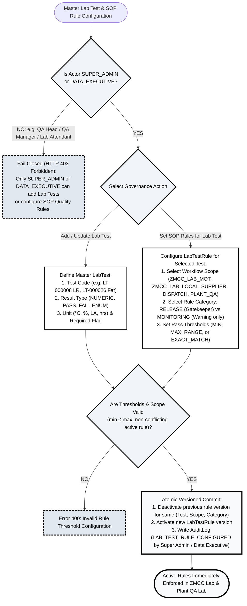

---

## 3. Level 0B: Finance Role — ERP Code Master Governance (`Add / Edit / Activate`) & Date-Range Rate Card (`from_date` to `to_date`)

**Authorized Actors**: `FINANCE_MANAGER` / `FINANCE_OPERATOR` (`FINANCE_TEAM`), `SUPER_ADMIN`  
*(Previously `ZMCC_MANAGER` could add/activate `ZmccMilkSource` ERP codes; this authority is now strictly transferred to **`FINANCE_TEAM` & `SUPER_ADMIN`**)*.  
**Workspace**: `/department/finance/erp-codes` & `/department/finance/erp-rates`  
**Domain Models**: `ZmccMilkSource` (`erp_code`), `ErpMilkPricingRule`, `ErpMilkRateSchedule`, `ErpSettlementLedger`

```mermaid
flowchart TD
    START_FIN(["Finance ERP Code & Rate Card Governance"]) --> CHK_FIN_ROLE{"Is Actor in FINANCE_TEAM<br/>or SUPER_ADMIN?"}

    CHK_FIN_ROLE -->|NO: e.g. ZMCC Manager / PHE Operator| ERR_403_FIN["Fail Closed (HTTP 403 Forbidden):<br/>ZMCC Manager & PHE cannot create, edit, or deactivate ERP Codes.<br/>Only Finance Team / Super Admin owns ERP Code Master Data."]

    CHK_FIN_ROLE -->|YES| FIN_OP_TYPE{"Select Finance Action"}

    %% Action 1: Create / Edit / Activate / Deactivate ERP Code
    FIN_OP_TYPE -->|Create / Edit / Activate ERP Code| ERP_MASTER_FORM["Manage ERP Code Master Record:<br/>1. Enter Unique erp_code (e.g. ERP-10045)<br/>2. Enter Account / Milk Source Name & Entity Type:<br/>   • VILLAGE_SHOP_SOURCE (for MOT Shops)<br/>   • LOCAL_SUPPLIER_SOURCE (for ZMCC Direct Suppliers)<br/>   • CONTRACTOR_SOURCE (for Plant Direct Contractors)<br/>3. Set Status: is_active = true / false"]

    ERP_MASTER_FORM --> CHK_DEACTIVATE{"If Deactivating (is_active = false):<br/>Are any Active Shops, Suppliers, or<br/>Contractors still mapped to this erp_code?"}

    CHK_DEACTIVATE -->|YES: Still Linked| ERR_IN_USE["Error 409 Conflict:<br/>Cannot deactivate ERP Code while linked to active Shops/Suppliers.<br/>Reassign them to a new ERP Code first."]
    CHK_DEACTIVATE -->|NO / Activating or Editing| SAVE_ERP_MASTER["Save ERP Code Master & Emit AuditLog (ERP_CODE_MASTER_SAVED)"]

    SAVE_ERP_MASTER --> SELECT_MILK_RULE

    %% Action 2: Set Milk Rule & Date-Range Rate
    FIN_OP_TYPE -->|Set Milk Rule & Date-Range Rate| SELECT_MILK_RULE["1. Select Milk Pricing Rule against erp_code:<br/>• Settlement Basis: '@13% TS Liters' (Default) OR 'Gross Liters'<br/>• Standard TS Factor (13.0% TS)"]

    SELECT_MILK_RULE --> SET_RATE_WINDOW["2. Set Effective Date-Range Milk Rate against erp_code:<br/>• Rate in PKR per Liter (e.g. PKR 202.50)<br/>• Effective Start Date: from_date (YYYY-MM-DD)<br/>• Effective End Date: to_date (YYYY-MM-DD)"]

    SET_RATE_WINDOW --> CHK_DATE_VALID{"Is from_date ≤ to_date?"}
    CHK_DATE_VALID -->|NO| ERR_DATE_ORDER["Error 400: from_date cannot be after to_date."]

    CHK_DATE_VALID -->|YES| CHK_OVERLAP{"Does [from_date, to_date] overlap an existing<br/>rate window for this SAME erp_code?"}

    CHK_OVERLAP -->|YES| AUTO_SPLIT{"Did Finance select 'Auto-Close Previous Period'?"}
    AUTO_SPLIT -->|NO| ERR_OVERLAP["Error 409 Conflict: Overlapping rate dates for this ERP Code."]
    AUTO_SPLIT -->|YES| CLOSE_OLD_RATE["Update previous rate row: to_date = (new from_date - 1 day)"]

    CLOSE_OLD_RATE --> SAVE_RATE_TX
    CHK_OVERLAP -->|NO: Clean Window| SAVE_RATE_TX

    SAVE_RATE_TX["Atomic Finance Rate Commit:<br/>• Insert ErpMilkRateSchedule (erp_code, rate_pkr, from_date, to_date)<br/>• Write AuditLog (ERP_MILK_RATE_SCHEDULED)"]

    classDef proc fill:#ffffff,stroke:#000000,color:#000000,stroke-width:2px;
    classDef decision fill:#f1f5f9,stroke:#000000,color:#000000,stroke-width:2.5px;
    classDef danger fill:#e2e8f0,stroke:#000000,color:#000000,stroke-width:3px,stroke-dasharray: 6 3;
    classDef success fill:#f8fafc,stroke:#000000,color:#000000,stroke-width:3.5px;

    class ERP_MASTER_FORM,SAVE_ERP_MASTER,SELECT_MILK_RULE,SET_RATE_WINDOW,CLOSE_OLD_RATE,SAVE_RATE_TX proc;
    class CHK_FIN_ROLE,FIN_OP_TYPE,CHK_DEACTIVATE,CHK_DATE_VALID,CHK_OVERLAP,AUTO_SPLIT decision;
    class ERR_403_FIN,ERR_IN_USE,ERR_DATE_ORDER,ERR_OVERLAP danger;
    class SAVE_ERP_MASTER,SAVE_RATE_TX success;
```

---

## 4. Level 0C: How to Edit Shop (`ZmccShop`) or Local Supplier (`ZmccLocalSupplier`) When Switching to a New ERP Code (100% Historical Preservation Workflow)

**Why this workflow is needed**:
If a **Village Shop (`SHP-001`)** or **Local Supplier (`ZLS-000001`)** requests to work under a **new `erp_code` (`ERP-NEW-202`)** instead of their previous `erp_code` (`ERP-OLD-101`):
- **Do we create a new duplicate Shop or Supplier?** **NO!** Creating a duplicate shop/supplier breaks route stop ordering, duplicates physical CNIC/phone directories, and splits operational history.
- **How do we preserve 100% of past records under `ERP-OLD-101` while routing future records to `ERP-NEW-202`?**
  1. **Master ERP Code Created by Finance**: First, Finance ensures `ERP-NEW-202` exists, is `is_active = true`, and has an active Rate Schedule (`from_date` $\rightarrow$ `to_date`).
  2. **Effective-Dated ERP Assignment History (`ErpAssignmentHistory`)**: When editing the Shop (`ZmccShop`) or Local Supplier (`ZmccLocalSupplier`), the system closes the old mapping row (`erp_code = 'ERP-OLD-101'`, `effective_to = now`) and inserts a new active mapping row (`erp_code = 'ERP-NEW-202'`, `effective_from = now`, `is_current = true`).
  3. **Immutable `erp_code_snapshot` on Every Transaction**: Every `MotShopCollection` (for Shops) and `ZmccTankReceipt` / `ErpSettlementLedger` (for Local Suppliers) stores an immutable `erp_code_snapshot` + `applied_rate_snapshot` captured at transaction time. Therefore, **all past milk collections and ledger balances under `ERP-OLD-101` are permanently preserved and never altered**, while **all new collections from the switch forward automatically post to `ERP-NEW-202`**!

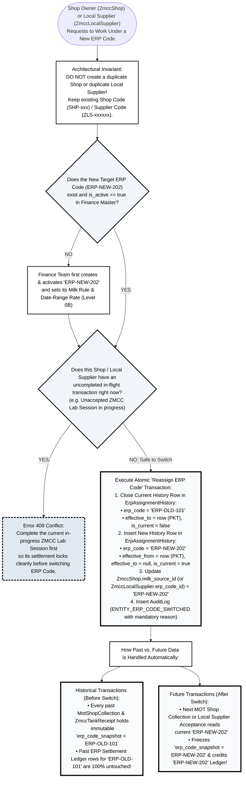

---

## 5A. Level 1A: MOT Master Fleet Registration & Journey Assignment / Dispatch

**Authorized Actors**:
- **Add / Edit MOT Vehicles & MOT Profiles**: `ZMCC_MANAGER` (scoped to assigned ZMCC) or `SUPER_ADMIN`. *(`PHE_OPERATOR` is strictly blocked with `403 Forbidden`)*.
- **Create / Assign & Dispatch MOT Journey**: `PHE_OPERATOR`, `ZMCC_MANAGER`, or `SUPER_ADMIN`.  
**Workspaces**: `/super-admin/mot-operations`, `/zmcc/mot`, `/phe`  
**Domain Models**: `MotVehicle`, `MotProfile`, `ZmccRoute`, `ZmccShop`, `MotJourney`, `MotJourneyStop`, `MotJourneyLocation`

```mermaid
flowchart TD
    START_ADMIN(["MOT Pre-Journey Setup & Dispatch"]) --> NEED_FLEET{"Need to Register New MOT Vehicle<br/>or New MOT Profile?"}

    %% Fleet & Profile Registration Branch
    NEED_FLEET -->|YES: Register Vehicle / Profile| CHK_FLEET_ROLE{"Is Actor ZMCC_MANAGER<br/>or SUPER_ADMIN?"}
    
    CHK_FLEET_ROLE -->|NO: e.g. PHE_OPERATOR| ERR_403_FLEET["Error 403 Forbidden:<br/>PHE Operators cannot create/update<br/>MOT Vehicles or MOT Profiles."]
    
    CHK_FLEET_ROLE -->|YES| FLEET_TYPE{"Select Registration Type"}

    %% Add Vehicle
    FLEET_TYPE -->|Add New MOT Vehicle| VEH_FORM["POST /api/zmcc/mot/vehicles:<br/>1. Enter vehicle_number (Normalized Uppercase)<br/>2. Select Target ZMCC (Auto-bound for ZMCC Manager)<br/>3. Optional: Vehicle Type, Capacity (L), Driver Name/Phone<br/>4. Category: STANDARD or EMERGENCY_SUBSTITUTE"]
    
    VEH_FORM --> CHK_VEH_DUP{"Is vehicle_number globally unique?"}
    CHK_VEH_DUP -->|NO| ERR_VEH_DUP["Error 409 Conflict:<br/>MOT Vehicle number already exists."]
    CHK_VEH_DUP -->|YES| SAVE_VEH["Atomic DB Transaction:<br/>• Insert MotVehicle (is_active = true)<br/>• Insert AuditLog (MOT_VEHICLE_CREATED or<br/>  EMERGENCY_SUBSTITUTE_VEHICLE_REGISTERED)"]

    %% Add Profile
    FLEET_TYPE -->|Add New MOT Profile| PROF_FORM["POST /api/zmcc/mot/profiles:<br/>1. Enter mot_code, Full Name, Phone, 13-digit CNIC<br/>2. Link User Account (role = 'MOT', scope = 'SOURCE', same ZMCC)"]
    
    PROF_FORM --> CHK_PROF_VALID{"Are mot_code & linked MOT User<br/>unique and valid for this ZMCC?"}
    CHK_PROF_VALID -->|NO| ERR_PROF["Error 400 / 409:<br/>Invalid user role/ZMCC or duplicate MOT code/user link."]
    CHK_PROF_VALID -->|YES| SAVE_PROF["Atomic DB Transaction:<br/>• Insert MotProfile (is_active = true)<br/>• Insert AuditLog (MOT_PROFILE_CREATED)"]

    SAVE_VEH --> DISPATCH_ENTRY
    SAVE_PROF --> DISPATCH_ENTRY
    NEED_FLEET -->|NO: Fleet & Profile Already Exist| DISPATCH_ENTRY

    %% Journey Assignment & Dispatch Branch
    DISPATCH_ENTRY["Initiate 'Assign & Dispatch MOT Journey'<br/>POST /api/zmcc/mot/journeys/assign-and-dispatch"] --> CHK_DISP_ROLE{"Is Actor PHE_OPERATOR,<br/>ZMCC_MANAGER, or SUPER_ADMIN?"}

    CHK_DISP_ROLE -->|NO| ERR_403_DISP["Error 403 Forbidden:<br/>Unauthorized to assign & dispatch MOT journeys."]

    CHK_DISP_ROLE -->|YES| SELECT_PARAMS["Select Dispatch Parameters:<br/>1. Active ZmccRoute (with ≥ 1 active ZmccShop)<br/>2. Active MotProfile (same ZMCC)<br/>3. Active MotVehicle (same ZMCC)<br/>4. Dispatcher GPS (lat, lng, accuracy) & idempotency_key"]

    SELECT_PARAMS --> CHK_ACTIVE_J{"Does MOT Profile OR MOT Vehicle<br/>already have an active 'COLLECTING' journey?"}
    CHK_ACTIVE_J -->|YES| ERR_BUSY["Error 409 Conflict:<br/>MOT Profile or Vehicle is already on an active journey."]

    CHK_ACTIVE_J -->|NO| CHK_INSIDE_ZMCC{"Is MOT Vehicle physically inside ZMCC?<br/>(ZmccMotArrival: gate_exit_required = true<br/>AND exit_timestamp IS NULL)"}

    CHK_INSIDE_ZMCC -->|YES| ERR_INSIDE["Error 409 Conflict:<br/>Vehicle is still inside ZMCC.<br/>PHE Gate Exit must be recorded first."]

    CHK_INSIDE_ZMCC -->|NO: Vehicle Available| CREATE_JOURNEY_TX["Atomic Journey Creation Transaction:<br/>1. Allocate Sequence: MJ-YYYYMMDD-XXXX<br/>2. Insert MotJourney (status = 'COLLECTING', operational_date = Today PKT)<br/>3. Insert Initial MotJourneyLocation (source = 'ASSIGNING_USER')<br/>4. Deterministically Snapshot Active Route Shops into<br/>   MotJourneyStop rows (including each Shop's current erp_code_snapshot)<br/>5. Insert AuditLog"]

    CREATE_JOURNEY_TX --> READY_FOR_MOT(["Journey Dispatched → Appears Live on MOT App (/mot)"])

    classDef proc fill:#ffffff,stroke:#000000,color:#000000,stroke-width:2px;
    classDef decision fill:#f1f5f9,stroke:#000000,color:#000000,stroke-width:2.5px;
    classDef danger fill:#e2e8f0,stroke:#000000,color:#000000,stroke-width:3px,stroke-dasharray: 6 3;
    classDef success fill:#f8fafc,stroke:#000000,color:#000000,stroke-width:3.5px;

    class VEH_FORM,SAVE_VEH,PROF_FORM,SAVE_PROF,DISPATCH_ENTRY,SELECT_PARAMS,CREATE_JOURNEY_TX,READY_FOR_MOT proc;
    class NEED_FLEET,CHK_FLEET_ROLE,FLEET_TYPE,CHK_VEH_DUP,CHK_PROF_VALID,CHK_DISP_ROLE,CHK_ACTIVE_J,CHK_INSIDE_ZMCC decision;
    class ERR_403_FLEET,ERR_VEH_DUP,ERR_PROF,ERR_403_DISP,ERR_BUSY,ERR_INSIDE danger;
    class CREATE_JOURNEY_TX,READY_FOR_MOT success;
```

---

## 5B. Level 1B: Upstream Mobile Milk Collection & Stream 1 Shop ERP Ledger Posting

**Primary Actor**: `MOT` (Mobile Milk Collection Officer)  
**Workspace**: `/mot`  
**Domain Models**: `MotJourney`, `MotJourneyStop`, `MotShopCollection`, `MotJourneySummary`, `ErpSettlementLedger`

```mermaid
flowchart TD
    START(["MOT Opens Active Assigned Journey<br/>(GET /api/zmcc/mot/journeys/current)"]) --> PREP_OFFLINE["Download Offline Journey Snapshot<br/>(Ordered MotJourneyStop list with Shop erp_code cached in IndexedDB)"]

    PREP_OFFLINE --> STOP_LOOP["Arrive at Next Planned Village Shop Stop"]
    STOP_LOOP --> ACTION{"Shop Action Decision"}

    ACTION -->|Skip Stop| SKIP_REASON["Select Skip Reason & Submit"]
    SKIP_REASON --> MARK_SKIP["Stop status = 'SKIPPED' (Zero Ledger Posted)"]
    MARK_SKIP --> NEXT_STOP{"More Shops to visit?"}

    ACTION -->|Collect Milk| COLL_FORM["Enter Shop Collection Details:<br/>1. Shop RMR Number (Paper)<br/>2. Quantity (Liters / KG)<br/>3. QA: LR & Fat<br/>4. Temp, Acidity, Alcohol + Live GPS"]
    
    COLL_FORM --> VAL_SHOP{"Is device online?"}
    
    VAL_SHOP -->|NO / Offline| PWA_QUEUE["Store in Local IndexedDB / Dexie Queue<br/>(device_collected_at = PKT timestamp)"]
    VAL_SHOP -->|YES / Online| POST_COLL["POST /api/zmcc/mot/journeys/current/collections"]

    PWA_QUEUE --> RETRY_SYNC["Network Restored → Replay Queue"]
    RETRY_SYNC --> POST_COLL

    POST_COLL --> CHK_LOCK{"Acquire Row Lock on Journey<br/>(SELECT FOR UPDATE)"}
    CHK_LOCK --> CHK_ENDED{"Is device_collected_at ≤ journey.ended_at?"}
    
    CHK_ENDED -->|NO| REJ_LATE["Reject Late Collection (HTTP 400)<br/>(Cannot record after journey arrival at ZMCC)"]
    
    CHK_ENDED -->|YES| CALC_SHOP_METRICS["1. Compute Canonical Shop Metrics:<br/>• Density = 1 + (LR / 1000)<br/>• Gross Liters = (KG / Density) or Declared Liters<br/>• SNF = (LR / 4) + (0.22 * Fat) + 0.72<br/>• TS = Fat + SNF<br/>• @13% TS Liters = (Gross Liters * TS) / 13"]

    CALC_SHOP_METRICS --> POST_SHOP_ERP_LEDGER["2. Stream 1 — Immediate Shop ERP Settlement Ledger Posting:<br/>• Read Shop's Active erp_code (freeze as erp_code_snapshot)<br/>• Lookup Finance ERP Rate where: from_date ≤ operational_date ≤ to_date<br/>• Payable Liters = @13% TS Liters (or Gross Liters per ERP Rule)<br/>• Payable Amount (PKR) = Payable Liters × Active ERP Rate<br/>• Insert ErpSettlementLedger row against Shop's erp_code<br/>  (Accumulates balance across every shop visited!)"]

    POST_SHOP_ERP_LEDGER --> RECOMP_SUMM["3. Atomically Recompute MotJourneySummary & Queue Shop SMS:<br/>(Sum Liters, Weighted LR/Fat/TS, Bump revision)"]
    RECOMP_SUMM --> NEXT_STOP

    NEXT_STOP -->|YES: Go to Next Shop| STOP_LOOP
    NEXT_STOP -->|NO: All Stops Done| ARRIVE_ZMCC(["Drive MOT Vehicle to ZMCC Chiller Facility"])

    classDef proc fill:#ffffff,stroke:#000000,color:#000000,stroke-width:2px;
    classDef decision fill:#f1f5f9,stroke:#000000,color:#000000,stroke-width:2.5px;
    classDef danger fill:#e2e8f0,stroke:#000000,color:#000000,stroke-width:3px,stroke-dasharray: 6 3;
    classDef success fill:#f8fafc,stroke:#000000,color:#000000,stroke-width:3.5px;

    class PREP_OFFLINE,STOP_LOOP,SKIP_REASON,MARK_SKIP,COLL_FORM,PWA_QUEUE,POST_COLL,RETRY_SYNC,CALC_SHOP_METRICS,RECOMP_SUMM,ARRIVE_ZMCC proc;
    class ACTION,VAL_SHOP,CHK_LOCK,CHK_ENDED,NEXT_STOP decision;
    class REJ_LATE danger;
    class POST_SHOP_ERP_LEDGER,RECOMP_SUMM success;
```

---

## 6. Level 2: ZMCC Intake & Gate Reception (PHE Gate Workflow & Local Supplier ERP Code Binding)

**Primary Actor**: `PHE_OPERATOR` (Public Health Engineer / Receptionist)  
**Workspace**: `/phe`  
**Domain Models**: `ZmccMotArrival`, `ZmccLocalSupplierArrival`, `ZmccLocalSupplier`

```mermaid
flowchart TD
    ARRIVE(["Vehicle Arrives at ZMCC Gate"]) --> STREAM_TYPE{"Select Arrival Type"}

    STREAM_TYPE -->|MOT Milk Route| MOT_GATE["Select Active MOT Journey"]
    STREAM_TYPE -->|Local Farmer / Supplier| LS_GATE["Search / Select Local Supplier Directory"]

    LS_GATE --> LS_EXISTS{"Does Local Supplier already exist in ZMCC?"}
    
    LS_EXISTS -->|NO: New Local Supplier| FAST_CREATE["Register New Local Supplier:<br/>1. Enter Name, Phone, 13-digit CNIC<br/>2. Select Active ERP Code (erp_code created by Finance Team)<br/>3. Initialize ErpAssignmentHistory (effective_from = now)"]
    FAST_CREATE --> ASSIGN_CODE["Sequence allocates: ZLS-000001<br/>(Bound to selected erp_code)"]
    ASSIGN_CODE --> ENTER_LS_DATA
    
    LS_EXISTS -->|YES: Existing Supplier| ENTER_LS_DATA["Load Existing Supplier Info & Linked Active erp_code<br/>Enter Vehicle Number & Slip Details"]

    MOT_GATE --> FORM_ENTRY["Enter Physical Paper Token:<br/>raw_milk_token_number (digits only)"]
    ENTER_LS_DATA --> FORM_ENTRY

    FORM_ENTRY --> ADVISORY_LOCK["Acquire PostgreSQL Advisory Lock:<br/>RAW_MILK_TOKEN:zmccId:tokenValue"]
    
    ADVISORY_LOCK --> CHK_DUP_TOKEN{"Is Paper Token already active<br/>in this ZMCC today?"}
    CHK_DUP_TOKEN -->|YES| ERR_DUP["Error 400: Duplicate raw_milk_token_number.<br/>Paper token already used in this facility."]
    
    CHK_DUP_TOKEN -->|NO| GEN_TOKEN["Generate Immutable System ZMCC Token:<br/>MOT: ZT-MOT-YYYYMMDD-XXXX<br/>LS:  ZT-LS-YYYYMMDD-XXXX"]

    GEN_TOKEN --> SAVE_ARRIVAL["Save Arrival Record in DB Transaction:<br/>• arrival_timestamp = now (PKT)<br/>• gate_exit_required = true, exit_timestamp = null<br/>• If Local Supplier: Freeze supplier erp_code_snapshot on arrival<br/>• If MOT: journey.status = 'COMPLETED' & ended_at = now"]

    SAVE_ARRIVAL --> QUEUE_LAB["Vehicle is Inside ZMCC → Displayed in QA Lab Queue"]

    classDef proc fill:#ffffff,stroke:#000000,color:#000000,stroke-width:2px;
    classDef decision fill:#f1f5f9,stroke:#000000,color:#000000,stroke-width:2.5px;
    classDef danger fill:#e2e8f0,stroke:#000000,color:#000000,stroke-width:3px,stroke-dasharray: 6 3;
    classDef success fill:#f8fafc,stroke:#000000,color:#000000,stroke-width:3.5px;

    class MOT_GATE,LS_GATE,FAST_CREATE,ASSIGN_CODE,ENTER_LS_DATA,FORM_ENTRY,ADVISORY_LOCK,GEN_TOKEN,SAVE_ARRIVAL,QUEUE_LAB proc;
    class STREAM_TYPE,LS_EXISTS,CHK_DUP_TOKEN decision;
    class ERR_DUP danger;
```

---

## 7. Level 3: ZMCC Laboratory Testing, Tank Receipt & Stream 2 Local Supplier ERP Settlement

**Primary Actors**: `ZMCC_LAB_ATTENDANT` (Testing) & `ZMCC_MANAGER` (Supervisory Review)  
**Rule Authority**: Evaluated strictly against active SOP rules configured by `SUPER_ADMIN` / `DATA_EXECUTIVE`  
**Workspace**: `/zmcc/lab`  
**Domain Models**: `ZmccLabSession`, `ZmccLabResult`, `ZmccTankReceipt`, `ZmccTankInventoryTransaction`, `ErpSettlementLedger`

```mermaid
flowchart TD
    START_LAB(["Start ZMCC Lab Testing Session"]) --> SNAPSHOT["Freeze Active Lab Tests Snapshot<br/>(Configured by SUPER_ADMIN / DATA_EXECUTIVE for ZMCC Scope)"]
    
    SNAPSHOT --> ENTER_RES["Enter Lab Observations:<br/>1. Milk Quantity (Value & Unit: KG/Liters)<br/>2. Measured LR & Fat<br/>3. Temperature, Acidity, Alcohol 68%, MBRT, Adulterants"]

    ENTER_RES --> FORMULA_ENGINE["Canonical Formula Execution:<br/>• Density = 1 + LR / 1000<br/>• Gross Liters = (KG / Density) or Declared Liters<br/>• SNF = LR / 4 + 0.22 * Fat + 0.72<br/>• TS = Fat + SNF<br/>• @13% TS Liters = Gross Liters * TS / 13"]

    FORMULA_ENGINE --> EVAL_RULES["System QA SOP Rules Evaluation<br/>(Evaluated against Active Rules set by SUPER_ADMIN / DATA_EXECUTIVE)"]

    EVAL_RULES --> CHK_CONFIG{"Any Rule Configuration Error<br/>or Missing Release Rule?"}
    
    CHK_CONFIG -->|YES| FAIL_CLOSED["Fail Closed (HTTP 400):<br/>RULE_CONFIGURATION_ERROR / NO_ACTIVE_RULE.<br/>Manager Override is strictly blocked!"]
    
    CHK_CONFIG -->|NO| CHK_RELEASE{"Do all RELEASE rules PASS?"}

    %% Branch 1: Normal Pass
    CHK_RELEASE -->|YES: All Rules PASS| LAB_DECISION{"Lab Attendant Decision"}
    
    LAB_DECISION -->|REJECTED| REJ_REASON["Enter Mandatory Rejection Reason"]
    REJ_REASON --> MARK_REJ["Status = 'COMPLETED', Decision = 'REJECTED'<br/>Zero Tank Receipt  /  Zero Stock  /  Zero ERP Ledger Posted"]

    LAB_DECISION -->|ACCEPTED| ACCEPT_RECEIVE["Initiate 'Accept & Receive' DB Transaction"]

    %% Branch 2: Out of Spec Escalation
    CHK_RELEASE -->|NO: OUT_OF_SPEC| AUTO_HOLD["System Outcome = 'OUT_OF_SPEC'<br/>Lab Attendant cannot Accept.<br/>Auto-Escalate to ZMCC Manager Review Queue (HOLD)"]

    AUTO_HOLD --> MGR_REVIEW{"ZMCC Manager Supervisory Review"}

    MGR_REVIEW -->|REJECTED| MGR_REJ["Decision = 'REJECTED'<br/>Mandatory Manager Reason Logged to AuditLog"]
    
    MGR_REVIEW -->|ACCEPTED| MGR_EXC["Decision = 'ACCEPTED'<br/>Mandatory Manager Reason (min 5 chars) Logged"]
    MGR_EXC --> ACCEPT_RECEIVE

    %% Tank Receipt & Stock Posting
    ACCEPT_RECEIVE --> LOCK_TANK["Lock Sole Active ZMCC Tank (SELECT FOR UPDATE)"]
    LOCK_TANK --> CHK_TANK_EXISTS{"Does exactly 1 active Tank exist<br/>for this ZMCC?"}
    
    CHK_TANK_EXISTS -->|NO 0 or gt 1 tanks| ERR_TANK["Error 400: Active tank configuration error"]
    CHK_TANK_EXISTS -->|YES| CHK_CAP["Compute Dynamic Stock = Sum(RECEIPTS) - Sum(ISSUES)"]
    
    CHK_CAP --> HAS_SPACE{"Is Gross Liters ≤ (Capacity - Current Stock)?"}
    
    HAS_SPACE -->|NO| ERR_CAP["Error 400: Insufficient Tank Capacity"]
    HAS_SPACE -->|YES| POST_STOCK["1. Atomic ZMCC Tank Stock Mutation:<br/>• Create ZmccTankReceipt (1:1 Snapshot)<br/>• Insert ZmccTankInventoryTransaction ('RECEIPT')<br/>• Session status = 'COMPLETED'"]

    POST_STOCK --> CHK_ARRIVAL_STREAM{"Is Accepted Milk from<br/>LOCAL_SUPPLIER or MOT?"}

    CHK_ARRIVAL_STREAM -->|MOT Journey Arrival| MOT_ALREADY_SETTLED["No New Vendor ERP Payment Here:<br/>(Individual Village Shops were already settled<br/>in ERP Ledger at Level 1B during MOT Collection)"]

    CHK_ARRIVAL_STREAM -->|Local Supplier Arrival| POST_LS_ERP_LEDGER["2. Stream 2 — Immediate Local Supplier ERP Settlement Ledger Posting:<br/>• Read Local Supplier's erp_code (frozen as erp_code_snapshot)<br/>• Lookup Finance ERP Rate where: from_date ≤ operational_date ≤ to_date<br/>• Payable Liters = Accepted @13% TS Liters (per ERP Rule)<br/>• Payable Amount (PKR) = Accepted @13% TS Liters × Active ERP Rate<br/>• Insert ErpSettlementLedger row against Local Supplier's erp_code!"]

    classDef proc fill:#ffffff,stroke:#000000,color:#000000,stroke-width:2px;
    classDef decision fill:#f1f5f9,stroke:#000000,color:#000000,stroke-width:2.5px;
    classDef danger fill:#e2e8f0,stroke:#000000,color:#000000,stroke-width:3px,stroke-dasharray: 6 3;
    classDef success fill:#f8fafc,stroke:#000000,color:#000000,stroke-width:3.5px;

    class SNAPSHOT,ENTER_RES,FORMULA_ENGINE,EVAL_RULES,REJ_REASON,MARK_REJ,ACCEPT_RECEIVE,AUTO_HOLD,MGR_REJ,MGR_EXC,LOCK_TANK,POST_STOCK,MOT_ALREADY_SETTLED proc;
    class CHK_CONFIG,CHK_RELEASE,LAB_DECISION,MGR_REVIEW,CHK_TANK_EXISTS,HAS_SPACE,CHK_ARRIVAL_STREAM decision;
    class FAIL_CLOSED,ERR_TANK,ERR_CAP danger;
    class POST_STOCK,POST_LS_ERP_LEDGER success;
```

---

## 8. Level 4: ZMCC Gate Exit & Fleet Availability Restoration

**Primary Actor**: `PHE_OPERATOR`  
**Workspace**: `/phe`  

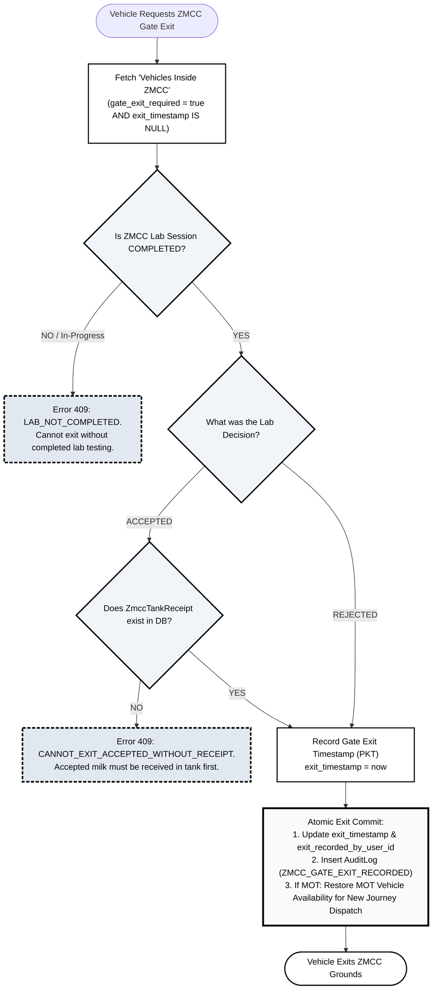

---

## 9. Level 5: Upstream Bulk Milk Dispatch (Independent Vehicle Quantity + Portion-Averaged Quality Formulas)

**Primary Actors**: `ZMCC_LAB_ATTENDANT` / `CONTRACTOR_OPERATOR` / `SUPER_ADMIN`  
**Workspace**: `/zmcc/dispatch` or `/contractor/manager`  
**Domain Models**: `VehicleVisit`, `DispatchInfo`, `VisitPortion`, `DispatchLabResult`

```mermaid
flowchart TD
    START_DISP(["Initiate New Milk Dispatch"]) --> SRC_BIND{"Is Operator Source-Bound?"}
    
    SRC_BIND -->|YES| LOCK_SRC["Auto-set assigned ProcurementSource<br/>(Company ZMCC or Direct Contractor with erp_code)"]
    SRC_BIND -->|NO / Admin| CHOOSE_SRC["Select Operating Procurement Source<br/>(Company ZMCC or Direct Contractor with erp_code)"]

    LOCK_SRC --> INP_VEH["1. Enter Independent Whole-Vehicle Dispatch Quantity:<br/>• Value (e.g. 10,000)<br/>• Unit: KG or LITER<br/>• Basis: Strictly 'MEASURED' (from Tank Flowmeter / Dipstick)<br/>• Entered independently (NOT summed from portion quantities)"]
    CHOOSE_SRC --> INP_VEH

    INP_VEH --> INP_PORT["2. Enter Portion / Compartment Quantities (Portion 1 to N):<br/>• Portion 1 sets shared Unit & Basis ('MEASURED' or 'ESTIMATED')<br/>• Subsequent portions inherit shared Unit/Basis<br/>• Informational comparison: Difference = (Vehicle Quantity - Sum of Portions)"]

    INP_PORT --> INP_PORT_QA["3. Enter Portion-Level Dispatch Quality Tests (Per Compartment 1..N):<br/>• Measured LR & Fat per Portion<br/>• Temperature, Acidity, Clot-on-Boil per Portion"]

    INP_PORT_QA --> PORT_COUNT{"How many Portions (Compartments)<br/>are on the Vehicle?"}

    PORT_COUNT -->|1 Single Portion| SINGLE_PORT_QA["Whole-Vehicle LR = Portion 1 LR<br/>Whole-Vehicle Fat = Portion 1 Fat"]

    PORT_COUNT -->|2 or More Portions N at least 2| AVG_PORT_QA["Derive Whole-Vehicle Quality from Average of Portion Tests:<br/>• Vehicle Composite LR = Arithmetic Average of Portion LRs (Sum LR_i / N)<br/>• Vehicle Composite Fat = Arithmetic Average of Portion Fats (Sum Fat_i / N)"]

    SINGLE_PORT_QA --> VEH_CANONICAL
    AVG_PORT_QA --> VEH_CANONICAL

    VEH_CANONICAL["4. Compute Whole-Vehicle Canonical Formulas<br/>(Using Independent Vehicle Quantity + Portion-Averaged Vehicle LR & Fat):<br/>• Vehicle Density = 1 + (Vehicle Average LR / 1000)<br/>• Vehicle Gross Liters = (Vehicle KG / Vehicle Density) or Declared Vehicle Liters<br/>• Vehicle SNF = (Vehicle Average LR / 4) + (0.22 * Vehicle Average Fat) + 0.72<br/>• Vehicle TS = Vehicle Average Fat + Vehicle SNF<br/>• Vehicle @13% TS Liters = (Vehicle Gross Liters * Vehicle TS) / 13"]

    VEH_CANONICAL --> INP_PAPER["5. Enter Paper Reference:<br/>raw_milk_dispatch_note_number (digits only)"]

    INP_PAPER --> CHECK_DISP_NOTE{"Is raw_milk_dispatch_note_number<br/>unique for this Source?"}
    
    CHECK_DISP_NOTE -->|NO| ERR_DISP_NOTE["Error 400: Duplicate dispatch note for this source."]
    CHECK_DISP_NOTE -->|YES| CREATE_VISIT["Create Database Records:<br/>1. VehicleVisit (current_status = 'DISPATCHED', stores Independent Vehicle Qty + Derived Vehicle LR, Fat, SNF, TS, @13TS)<br/>2. DispatchInfo (dispatch_timestamp = PKT)<br/>3. VisitPortion rows (status = 'DISPATCHED')<br/>4. DispatchLabResult rows (frozen per portion)"]

    CREATE_VISIT --> TANK_ISSUE["If ZMCC Source: Mutate ZMCC Tank Ledger Stock<br/>Insert ZmccTankInventoryTransaction ('ISSUE' using Vehicle Gross Liters)"]
    TANK_ISSUE --> TRANSIT(["Tanker in Transit to Plant"])

    classDef proc fill:#ffffff,stroke:#000000,color:#000000,stroke-width:2px;
    classDef decision fill:#f1f5f9,stroke:#000000,color:#000000,stroke-width:2.5px;
    classDef danger fill:#e2e8f0,stroke:#000000,color:#000000,stroke-width:3px,stroke-dasharray: 6 3;
    classDef success fill:#f8fafc,stroke:#000000,color:#000000,stroke-width:3.5px;

    class LOCK_SRC,CHOOSE_SRC,INP_VEH,INP_PORT,INP_PORT_QA,SINGLE_PORT_QA,AVG_PORT_QA,VEH_CANONICAL,INP_PAPER,CREATE_VISIT,TANK_ISSUE,TRANSIT proc;
    class SRC_BIND,PORT_COUNT,CHECK_DISP_NOTE decision;
    class ERR_DISP_NOTE danger;
    class VEH_CANONICAL,CREATE_VISIT success;
```

---

## 10. Level 6: Plant Admin & Gate Entry (`ADMIN_OPERATOR`)

**Primary Actor**: `ADMIN_OPERATOR` (formerly Security Operator)  
**Workspace**: `/department/admin-gate`  
**Domain Models**: `GateLog`, `VehicleVisit`

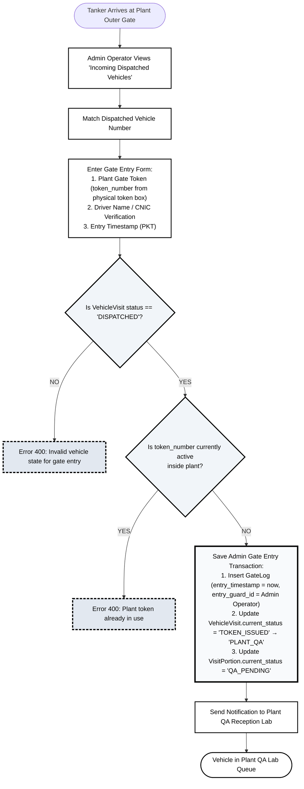

---

## 11. Level 7: Plant QA Laboratory Testing & Portions Decision Engine

**Primary Actors**: `QA_LAB_ATTENDANT` (Sampling & Testing) & `QA_MANAGER` (Supervisory Review)  
**Rule Authority**: Evaluated strictly against active SOP rules configured by `SUPER_ADMIN` / `DATA_EXECUTIVE`  
**Workspace**: `/department/qa` (Attendant) & `/department/qa-manager` (Manager)  
**Domain Models**: `QATestingSession`, `PlantLabResult`, `VisitPortion`

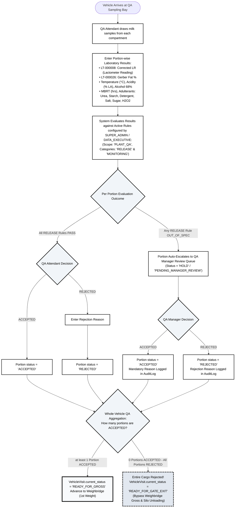

---

## 12. Level 8: Plant Weighbridge — First Weight (Loaded / Gross) & Authoritative Business Date Cutoff

**Primary Actor**: `WEIGHBRIDGE_OPERATOR`  
**Workspace**: `/department/weighbridge`  
**Domain Models**: `WeightTicket`, `VehicleVisit`

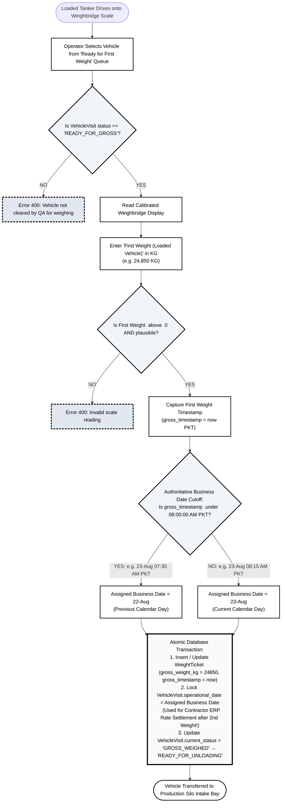

---

## 13. Level 9: Plant Silo Offloading & Production Reception

**Primary Actor**: `PRODUCTION_RECEPTION_OPERATOR`  
**Workspace**: `/department/production`  
**Domain Models**: `UnloadingLog`, `Silo`, `VisitPortion`, `VehicleVisit`

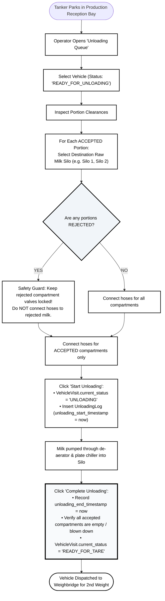

---

## 14. Level 10: Plant Weighbridge — Second Weight (Post-Unloading / Tare)

**Primary Actor**: `WEIGHBRIDGE_OPERATOR`  
**Workspace**: `/department/weighbridge`  
**Domain Model**: `WeightTicket`, `VehicleVisit`

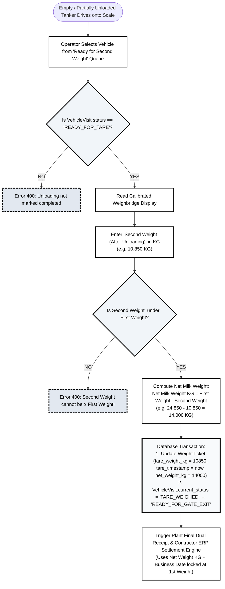

---

## 15. Level 11: Plant Final Dual Reconciliation, Silo Inventory Posting & Stream 3 Direct Contractor ERP Settlement

**Engine**: Automated Transactional Service (`reconciliationService.ts`, `siloInventoryService.ts`, `financeSettlementService.ts`)  
**Domain Models**: `SiloInventoryTransaction`, `PlantFinalDualReconciliation`, `ErpSettlementLedger`

```mermaid
flowchart TD
    TRIGGER(["Weighbridge 2nd Weight Completed (Net Weight KG Known)"]) --> CHK_MULTI_SILO{"Did accepted portions map to<br/>more than 1 destination Silo?"}

    %% Multi silo guard
    CHK_MULTI_SILO -->|YES: gt 1 Silos| BLOCK_MULTI["Error: MULTI_SILO_ALLOCATION_REQUIRED.<br/>Net KG exists only at vehicle scale level.<br/>Multi-silo split cannot be invented."]

    %% Single Silo Processing
    CHK_MULTI_SILO -->|NO: Exactly 1 Silo| LOCK_SILO["Acquire PostgreSQL Row Lock on Silo<br/>(SELECT FOR UPDATE)"]

    LOCK_SILO --> POST_LOCK_IDEMP{"Has receipt already been posted<br/>for this visit?"}
    
    POST_LOCK_IDEMP -->|YES| RETURN_EXISTING["Return Existing Final Receipt (Idempotent 200 OK)"]

    POST_LOCK_IDEMP -->|NO| CALC_PHYSICAL["1. Physical Calculation Chain (From Net Weight KG):<br/>• Plant Composite LR = Arithmetic Average of Accepted Portions<br/>• Plant Composite Fat = Arithmetic Average of Accepted Portions<br/>• Plant Density = 1 + (Plant Composite LR / 1000)<br/>• Received Gross Liters = Net KG / Plant Density"]

    CALC_PHYSICAL --> CALC_COMMERCIAL["2. Commercial Calculation Chain:<br/>• Plant SNF = (LR / 4) + (0.22 * Fat) + 0.72<br/>• Plant TS = Fat + SNF<br/>• Received @13% TS Liters = Received Gross Liters * TS / 13"]

    CALC_COMMERCIAL --> CALC_VARIANCE["3. Dual Variance Calculation:<br/>• Gross Vol Variance (L) = Received Gross Liters - Sent Gross Liters<br/>• Solids @13TS Variance (L) = Received @13TS - Sent @13TS"]

    CALC_VARIANCE --> POST_SILO_LEDGER["4. Post Silo Inventory & Dual Reconciliation:<br/>• Insert SiloInventoryTransaction (type = 'RECEIPT', quantity_liters = Gross Liters, quantity_kg = Net KG)<br/>• Insert PlantFinalDualReconciliation record<br/>• Generate Reception Number: REC-YYYYMMDD-XXXX"]

    POST_SILO_LEDGER --> CHK_SOURCE_TYPE{"5. Check ProcurementSource.source_type<br/>for ERP Settlement"}

    %% Branch A: Company ZMCC
    CHK_SOURCE_TYPE -->|source_type is ZMCC - Company-Owned Chiller| ZMCC_NO_PAY["Internal Company Stock Transfer Only:<br/>• Zero Vendor Payment at Plant Level<br/>• Upstream MOT Shops were already settled at Level 1B<br/>• Upstream Local Suppliers were already settled at Level 3"]

    %% Branch B: Direct Contractor
    CHK_SOURCE_TYPE -->|source_type is CONTRACTOR - External Direct Bulk Vendor| CONT_SETTLEMENT["Stream 3 — Direct Contractor ERP Settlement Ledger Posting:<br/>• Read Contractor ProcurementSource.erp_code (freeze as erp_code_snapshot)<br/>• Read Locked Business Date (operational_date from 1st Weight  under  08:00 AM PKT)<br/>• Lookup Finance ERP Rate where: from_date ≤ operational_date ≤ to_date<br/>• Payable Liters = Received @13% TS Liters (from Net Weight KG)<br/>• Payable Amount (PKR) = Received @13% TS Liters × Active ERP Rate<br/>• Insert ErpSettlementLedger row against Contractor's erp_code!"]

    ZMCC_NO_PAY --> READY_EXIT(["Vehicle Cleared for Plant Admin Gate Exit"])
    CONT_SETTLEMENT --> READY_EXIT

    classDef proc fill:#ffffff,stroke:#000000,color:#000000,stroke-width:2px;
    classDef decision fill:#f1f5f9,stroke:#000000,color:#000000,stroke-width:2.5px;
    classDef danger fill:#e2e8f0,stroke:#000000,color:#000000,stroke-width:3px,stroke-dasharray: 6 3;
    classDef success fill:#f8fafc,stroke:#000000,color:#000000,stroke-width:3.5px;

    class LOCK_SILO,RETURN_EXISTING,CALC_PHYSICAL,CALC_COMMERCIAL,CALC_VARIANCE,POST_SILO_LEDGER,ZMCC_NO_PAY,READY_EXIT proc;
    class CHK_MULTI_SILO,POST_LOCK_IDEMP,CHK_SOURCE_TYPE decision;
    class BLOCK_MULTI danger;
    class POST_SILO_LEDGER,CONT_SETTLEMENT success;
```

---

## 16. Level 12: Plant Admin Gate Exit & Visit Closure (`ADMIN_OPERATOR`)

**Primary Actor**: `ADMIN_OPERATOR` (formerly Security Operator)  
**Workspace**: `/department/admin-gate`  
**Domain Model**: `GateLog`, `VehicleVisit`

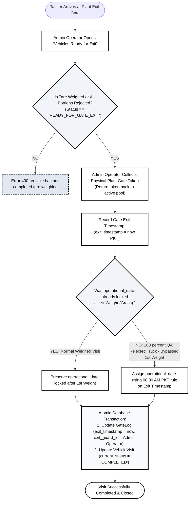

---

## 17. Level 13: Governance, Audited Corrections & Supervisory Overrides

**Governing Rules**: `CORRECTION_GOVERNANCE.md`, `CURRENT-RULES.md`  
**Authorized Actors**: `ZMCC_MANAGER`, `QA_MANAGER`, `SUPER_ADMIN`

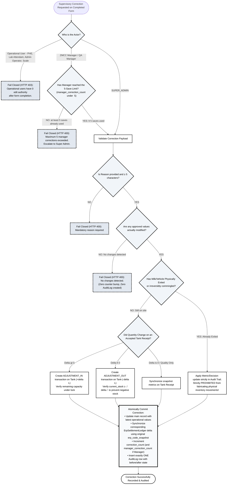

---

## 18. Summary Matrix: Key Decision Points & Strict Business Invariants

| Level | Decision / Condition | If YES (True) | If NO (False) | Authoritative Invariant |
|---|---|---|---|---|
| **Level 0A (Lab Tests & Rules)** | Actor is `SUPER_ADMIN` or `DATA_EXECUTIVE` | Can add `LabTest` and set `LabTestRule` (`RELEASE` vs `MONITORING`) | Rejected (`403 Forbidden` — `QA_HEAD` cannot add tests or set rules) | Only `SUPER_ADMIN` / `DATA_EXECUTIVE` governs test catalog & SOP thresholds |
| **Level 0B (Finance ERP Master & Rate Card)** | Actor is `FINANCE_TEAM` or `SUPER_ADMIN` | Creates/edits/activates/deactivates `erp_code` (`ZmccMilkSource`), assigns Milk Rule & Date-Range Rate (`from_date` $\rightarrow$ `to_date`) | Rejected (`403 Forbidden` for `ZMCC_MANAGER` / `PHE_OPERATOR`) | **Finance Team** owns ERP Code lifecycle and non-overlapping date-range rates |
| **Level 0C (Shop / Local Supplier ERP Switch)** | Shop (`ZmccShop`) or Local Supplier (`ZmccLocalSupplier`) switches to a new `erp_code` | Closes old row in `ErpAssignmentHistory` (`effective_to = now`), opens new `erp_code` row (`is_current = true`) | **Never** creates a duplicate Shop or duplicate Local Supplier | Past records stay permanently bound to old `erp_code` via `erp_code_snapshot`; future records post to new `erp_code` |
| **Level 1A (MOT Fleet & Journey)** | `ZMCC_MANAGER` / `SUPER_ADMIN` registers fleet; `PHE` / `ZMCC_MANAGER` dispatches | Allocates `MJ-YYYYMMDD-XXXX`, snapshots route shops (`MotJourneyStop`) | Rejected (`409 Conflict` if vehicle on active journey or inside ZMCC awaiting exit) | Route shops deterministically snapshotted (`area_code ASC, shop_code ASC, id ASC`) |
| **Level 1B (Stream 1: MOT Shop ERP Settlement)** | `MOT` submits shop collection (`device_collected_at <= journey.ended_at`) | Computes `@13% TS Liters` and **immediately credits `ErpSettlementLedger` against that Shop's `erp_code`** | Rejected if after journey arrival | Every village shop collection accumulates in the ERP Ledger against its `erp_code` |
| **Level 2 & 3 (Stream 2: Local Supplier ERP Settlement)** | ZMCC Lab decision is `ACCEPTED` for Local Supplier | Posts `ZmccTankReceipt` AND **immediately credits `ErpSettlementLedger` against that Local Supplier's `erp_code`** (`@13% TS Liters`) | If `REJECTED` (or if MOT arrival), zero new vendor payment at Level 3 | Local Supplier is settled at ZMCC upon lab acceptance according to `@13% TS` |
| **Level 5 (Dispatch Quantity vs Quality)** | Vehicle has $\ge 2$ Portions | **Quantity** is independent `MEASURED` fact; **Vehicle LR & Fat** are derived from **Average of Portion Lab Tests** | For 1 portion, Vehicle LR & Fat equal Portion 1 LR & Fat | Whole-Vehicle Canonical Formulas (`Density`, `Gross L`, `SNF`, `TS`, `@13% TS`) use **Independent Vehicle Qty + Portion-Averaged LR & Fat** |
| **Level 8 (1st Weight & Business Date Cutoff)** | `gross_timestamp < 08:00:00 AM PKT` | **Plant Business Date (`operational_date`) = Previous Calendar Day** | **Plant Business Date (`operational_date`) = Current Calendar Day** | **08:00 AM PKT cutoff is locked immediately after Weighbridge First Weight (`gross_timestamp`)** |
| **Level 11 (Stream 3: Contractor vs ZMCC Settlement)**| `ProcurementSource.source_type == 'CONTRACTOR'` (after 2nd Weight Net KG) | **Credits `ErpSettlementLedger` against Contractor's `erp_code`** (`Net KG` $\rightarrow$ `@13% TS`) using **ERP Rate of 1st-Weight Business Date** | If `source_type == 'ZMCC'`, internal transfer & Dual Variance only (no vendor payment) | Contractors settle after 2nd Weight (`Net KG`) against the Business Date locked at 1st Weight |
